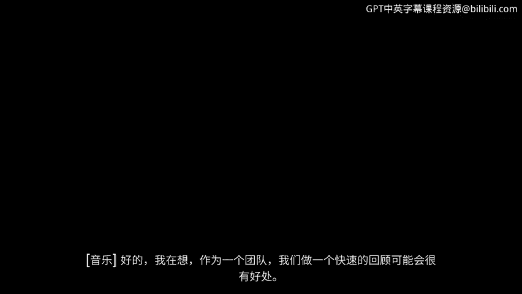
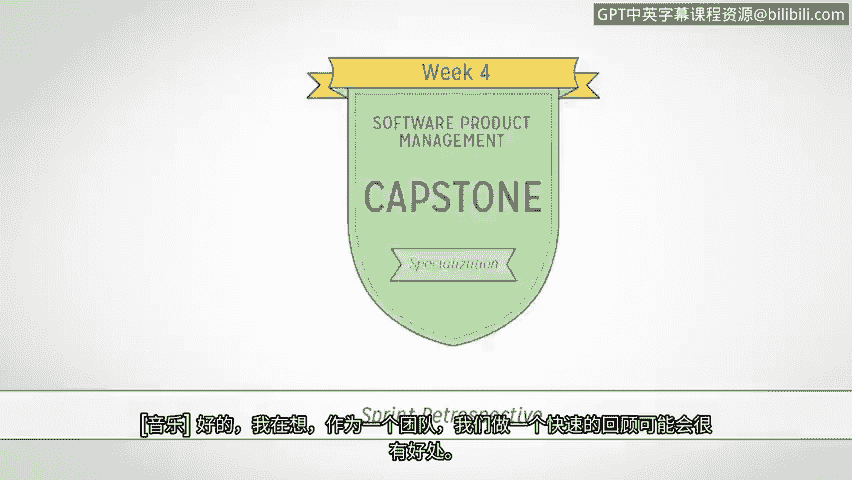

**软件产品管理：6：软件产品管理毕业项目**

**概述**
在本节中，我们将通过一个团队模拟冲刺回顾会议的对话，学习如何进行有效的敏捷回顾。我们将分析会议中讨论的正面成果、待改进之处以及为下一次冲刺制定的行动计划。

---

**模拟冲刺回顾会议**

团队决定进行一次快速的回顾会议，以从本次冲刺过程中学习经验，并为未来的工作带来益处。

以下是会议中讨论的要点。

**做得好的方面**
团队首先总结了本次冲刺中表现良好的地方。

*   完成了所有预期的用户故事。
*   坚持每天进行站会。
*   所有用户故事都满足了“完成的定义”。
*   最终交付了一个可工作的、令人印象深刻的产品。

**可以改进的方面**
随后，团队以改进为目的，坦诚地讨论了可以做得更好的地方。

*   在开始编写功能源代码之前，没有先编写单元测试。
*   在开始开发之前，应该先编写验收测试和验收标准。
*   任务板的使用可以改进，其在冲刺过程中未能准确反映实际进度。
*   团队沟通仍有提升空间。

**针对故事点估算的讨论**
团队评估了故事点估算的准确性。虽然所有任务都按时完成，但认为可能需要更多冲刺周期才能更准确地评估个体估算的精度。总体而言，估算被认为是合理的。

**下一冲刺的改进措施**
基于以上讨论，团队为下一次冲刺制定了具体的改进措施。

*   尽早编写验收测试和单元测试。
*   更频繁、及时地更新任务板。
*   尝试更多的结对编程，以促进知识共享和提升代码质量。
*   持续关注并改进团队沟通。

---

**总结**
本节课我们一起学习了一个完整的冲刺回顾会议模拟。有效的回顾包括：总结做得好的方面以保持优势，坦诚讨论待改进之处而不相互指责，并基于讨论结果制定具体的、可执行的改进措施，以帮助团队在下一个冲刺中持续进步。