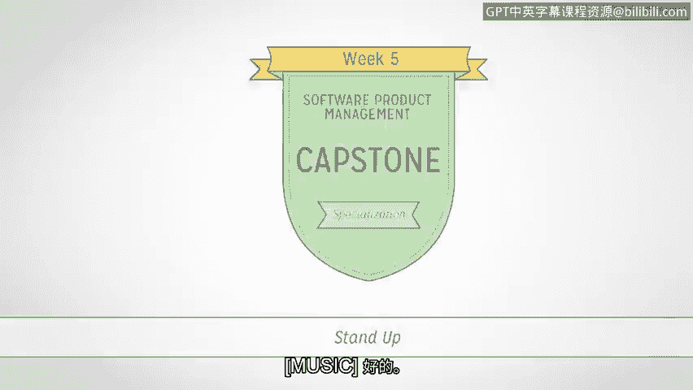

**软件产品管理毕业项目：5.1：视频模拟站立会议 星期一**

在本节课中，我们将通过一段视频模拟，学习如何在实际的敏捷开发环境中进行一次典型的站立会议。我们将观察团队成员如何同步进度、讨论任务依赖关系并协作解决问题。

---

上一节我们介绍了敏捷开发中的迭代规划。本节中，我们来看看在一个新迭代开始时，团队如何通过站立会议来启动工作。

以下是视频中模拟的站立会议对话内容：

Wilson首先发言：“我今天要开始处理数据库连接。因为我们这个迭代要完成的大部分用户故事，都以某种方式依赖于这个连接。乐观估计，我今天应该能完成，最晚明天。今天是第一天，我目前没有遇到阻碍。”

既然Wilson将负责数据库连接，Alexa接着说道：“那么我们可以完成一些设计元素，并创建验收测试和标准。”

Josh随后说明自己的计划：“接下来我来说。我将开始设计浏览和书签功能的界面。同时，我也会为‘浏览书籍封面’和‘书签’功能创建验收标准和测试。我目前唯一的阻碍是，最好能有数据库连接。但我可以先使用硬编码的数据开始编程，就像上个迭代那样，所以几天内应该没问题。不过要完成我的任务，最终还是需要数据库连接。我的意思是，我可以用假数据，但我觉得等数据库弄好会更方便。”

针对Josh的依赖，Alexa主动提出协作：“Josh，我也可以帮你做验收测试，这样你就可以集中精力处理那个连接。” Josh回应道：“我觉得可以。”

会议以团队共识结束：“让我们开始团队协作吧。”

---

本节课中，我们一起学习了模拟站立会议的流程。我们看到团队成员清晰地陈述了当日计划、任务间的依赖关系以及可能的阻碍，并通过主动协作来解决问题，这体现了敏捷沟通的核心价值。