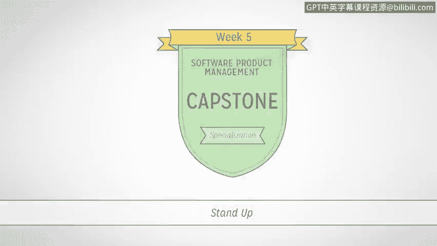

# 016：视频模拟站立会议

## 概述
在本节中，我们将通过一个视频模拟的站立会议场景，来了解敏捷开发团队在日常站会中如何同步进度、识别障碍并规划当日工作。你将看到团队成员如何简洁地汇报工作。

---

上一节我们介绍了敏捷开发中的迭代规划，本节中我们来看看团队如何在每日站会中保持同步。

以下是视频模拟中团队成员的工作汇报摘要：

*   **成员A（负责搜索功能）**：
    *   昨日完成了搜索功能的源代码编写，核心是一个搜索数据库的函数。
    *   今日计划将搜索功能连接到前端应用程序。
    *   依赖成员C完成的文档和验收测试。

*   **成员B（负责本地保存功能）**：
    *   本地保存功能已基本完成。
    *   昨日单元测试发现一些错误，但预计修复不难。
    *   今日计划修复这些测试错误，完成后此功能即告完成。
    *   目前没有遇到阻碍。

*   **成员C（负责浏览与书签功能）**：
    *   浏览功能已完成，书签可以显示。
    *   当前问题是书封面的显示尺寸不协调，视觉效果不佳。
    *   所有单元测试均已通过。
    *   今日计划花时间优化书封面的显示效果，并完成相关文档编写。
    *   目前没有遇到阻碍。

团队同步信息后，会议结束，成员开始当日工作。

---

## 总结
本节课中，我们一起学习了敏捷站立会议的模拟过程。通过三位成员的汇报，我们看到了站会的核心要素：**昨日进展、今日计划、遇到的障碍**。这种简短的同步机制有助于团队保持信息透明，快速发现问题并协调工作，确保项目朝着演示（Demo）的目标顺利推进。