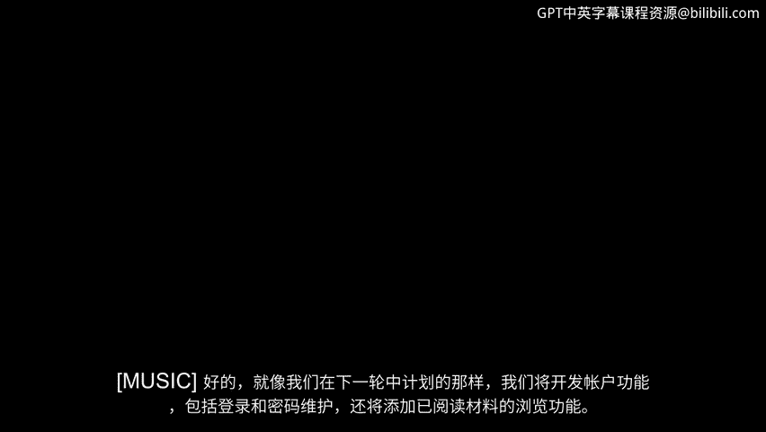
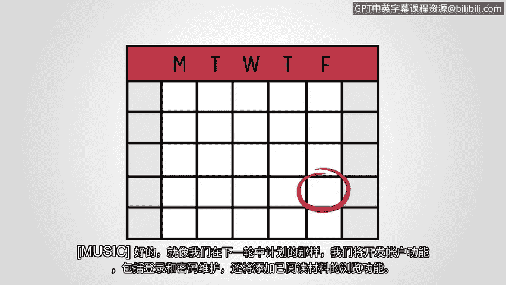

# 018：视频模拟积压工作细化

## 概述
在本节中，我们将通过一个视频模拟的对话场景，学习如何进行冲刺（Sprint）计划中的积压工作（Backlog）细化。我们将看到产品负责人和开发团队如何讨论下一个冲刺的功能优先级，权衡取舍，并最终确定冲刺待办事项列表。

---

## 冲刺计划讨论

上一节我们讨论了产品愿景和路线图，本节中我们来看看团队如何为下一个冲刺细化具体的用户故事和任务。

以下是团队成员对下一个冲刺（Sprint 3）初始计划的讨论。

*   开发登录和密码维护功能。
*   添加浏览已读材料的功能。
*   添加收藏夹列表和“待读”列表。
*   添加弹出式词典工具。
*   添加好友列表及与好友连接的功能。
*   加入在上一个冲刺中被移出的排序功能。

## 功能优先级调整

虽然许多功能能为产品增加趣味性，但团队认为它们可能不具备最大的教育影响力。点对点阅读功能很重要，但当前需要更多教育相关的功能。

团队一致认为，弹出式词典工具是下一个冲刺的必备功能。此外，产品负责人希望实现最初建议的阅读理解测试工具。

## 细化阅读理解功能

现在，哪些功能与阅读理解测试相关？之前，与理解测试相关的功能优先级较低，但团队现在可以将其优先级提升，以匹配新的产品重点。

与理解水平相关的功能包括：
*   测试流利度和阅读理解水平的能力。
*   根据用户的理解水平推荐材料。
*   应用程序跟踪阅读理解能力的提升。
*   通过语音识别跟踪提升。

关于语音识别功能，开发团队认为在一周内实现过于困难，因为识别特定语速和发音需要大量研究和编程工作。但其他所有功能都是可行的。

## 确定实施方案

既然无法实现语音识别，团队需要确定如何跟踪阅读理解水平。解决方案是采用一个结合书面和多项选择题的标准化阅读理解测试。

团队决定实施多项选择和书面测试。这意味着需要从当前的冲刺计划中移除一些功能，以容纳这些新的高优先级项目。

## 权衡与决策

如果添加测试理解水平、根据阅读水平提供建议、跟踪提升以及根据阅读水平匹配用户这些功能，总计需要11个故事点的工作量。因此，必须从当前的Sprint 3计划中移除相应工作量的任务。

团队考虑移除以下功能以释放8个故事点：
*   浏览已读材料。
*   连接好友及好友列表功能。

然而，团队发现当前阅读材料并没有对应的难度等级，因此无法实现“根据理解水平匹配材料”的功能。该功能将被记录，留待未来冲刺中数据库信息完善后再实现。

目前计划仍超出一个故事点，需要再削减一个用户故事。团队决定移除“重置密码”功能，因为对于即将到来的贸易展示会并非必需。

关于上一个冲刺移出的排序功能，团队认为当前不需要，优先完成其他功能更重要。

## 最终冲刺计划

经过讨论，团队为下一个冲刺确定了最终的功能列表：
*   账户功能（不含密码重置）。
*   “待读”列表。
*   收藏夹列表。
*   弹出式词典。
*   阅读理解测试及匹配功能。

团队对最终计划表示满意，认为它既包含了核心的教育功能，也保留了一些实用的趣味性功能。产品负责人将提供阅读理解测试的细节，并承诺在需要时提供支持。

---

## 总结
本节课中，我们一起学习了如何通过团队协作来细化冲刺积压工作。我们看到了产品负责人与开发团队如何就功能价值、实现难度进行讨论，通过权衡与取舍，从初始的功能列表中筛选并确定最终冲刺目标。这个过程确保了团队在有限的时间内，能够集中精力交付最高价值的产品增量。