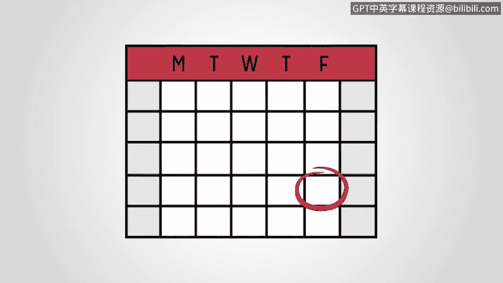

# 019：视频模拟冲刺回顾 🎬

在本节课中，我们将通过一个模拟的团队冲刺回顾会议，学习如何有效地进行敏捷开发中的回顾环节。我们将分析团队在冲刺中的成功之处、遇到的问题以及未来的改进计划。

---

上一节我们讨论了冲刺执行，本节中我们来看看如何对冲刺进行回顾与总结。一个高效的冲刺回顾会议能帮助团队持续改进。

团队完成了一次冲刺，并对应用成果感到满意。他们决定召开一次简短的回顾会议，为接下来的重要冲刺做好准备。

## 成功之处 ✅

以下是团队认为在本轮冲刺中做得好的方面：

*   **完成了用户故事**：团队最终坚持并完成了所有计划的用户故事。
*   **提前编写测试**：这是一个显著的改进，有助于保证代码质量。
*   **沟通顺畅**：每日站会富有成效，项目状态对所有人透明，这是从上轮冲刺改进而来的积极成果。
*   **保持积极与团队合作**：尽管遇到一些困难，但团队保持积极态度，共同协作克服了障碍。

## 不足之处 ❌

在总结优点后，团队开始审视本轮冲刺中可改进的地方。以下是他们识别出的问题：

*   **依赖关系管理不足**：例如，数据库连接本应在更早的冲刺中建立，因为它影响众多任务。这次虽然侥幸未出问题，但未来需更仔细地规划依赖。
*   **结对编程实践减少**：由于时间紧张，团队减少了结对编程。他们计划在下轮冲刺中重新尝试，例如以结对方式分配任务。
*   **故事点估算不准确**：团队承认最初的估算不够精确。幸运的是，他们在冲刺开始前重新评估并调整了计划，今后需要继续保持这个做法。

## 改进计划 🚀

分析了成功与不足之后，团队需要制定具体的行动方案来提升下一轮冲刺的效率。以下是他们提出的改进措施：

*   **推行结对编程**：在下一冲刺中尝试以结对形式分配任务，若效果不佳再调整。
*   **保持良好沟通**：维持当前高效的沟通状态，避免倒退。
*   **持续改进估算**：继续在冲刺开始前评估和校准故事点估算。

---

本节课中，我们一起学习了一个完整的冲刺回顾会议流程。团队系统地回顾了**成功之处**、**不足之处**，并制定了具体的**改进计划**。有效的回顾是敏捷团队持续学习和优化工作流程的关键。