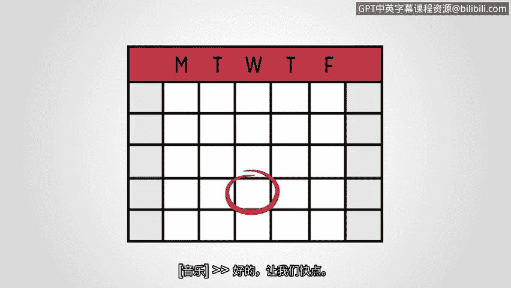

# 020：模拟站立会议视频分析


在本节课中，我们将通过分析一段模拟的团队站立会议视频，来学习如何有效地组织会议、识别问题并进行沟通。我们将重点关注会议流程、成员互动以及如何发现和处理开发过程中的障碍。



---

## 会议内容回顾

以下是模拟会议中各位成员的发言记录整理。

**成员A的发言：**
昨天我完成了Daniel布置的阅读理解测验，并将其开发成了一个功能模块。所有测试均已通过。我还完成了相关文档。目前只需要有人进行验收测试即可。Alexa已经完成了代码审查。
今天我将致力于根据阅读水平为远程用户进行匹配。

**成员A对成员C的请求：**
我希望在我开始着手跟踪阅读进度改进功能之前，你能完成相关账户的设置工作。没有账户我也可以做，但那样会节省大量时间。你预计什么时候能完成？

**成员C的回应：**
账户和登录功能已经完成了。太棒了。我也可以在今天晚些时候帮你运行那些验收测试，没问题。

**成员C的发言：**
我接下来汇报。正如我昨天所说，我完成了账户和登录功能。Daniel的建议应该能让登录流程对儿童更友好。我开始了定义查询功能，找到了一个儿童词典数据库，并从Lisa那里获得了所有必要的授权。目前，长按单词时会出现一个弹窗，但还没有实际功能。今天我将开始着手将定义查询连接到那个弹窗上。
我目前没有遇到阻碍。

**成员B的发言：**
昨天我在做浏览材料排序的功能。
我想我今天会继续做这个。

**成员A对成员B的质疑：**
等等，你不是应该在做收藏夹和待读列表功能吗？我以为排序功能已经被砍掉了。

**成员B的解释：**
我知道，但我对那个功能有很多想法，所以…我的意思是，那两个列表功能只需要一点时间就能做完。没什么大不了的。

**成员A的反对：**
不，这很重要。

**成员C的调解建议：**
好吧，我们先把这个问题放一放，等会议结束后再单独讨论。

**成员B的同意：**
好的，就这么办。

**成员B的后续发言：**
好吧，那我昨天就是在做那个（排序功能）。现在我也不太确定今天要做什么了。
我目前没有阻碍。

---

## 会议分析与关键点

上一节我们回顾了会议的具体对话，本节中我们来看看其中暴露出的关键问题与最佳实践。

### 会议流程的优点
1.  **轮询式发言**：会议基本遵循了轮流发言的模式，让每个成员都有机会汇报。
2.  **明确昨日成果与今日计划**：大部分成员清晰地说明了“昨天完成的工作”和“今天的计划”。
3.  **主动提出帮助**：成员C主动提出为成员A进行验收测试，体现了团队协作。

### 识别出的问题与改进建议
以下是会议中暴露出的几个主要问题。

1.  **偏离任务优先级**：
    *   **问题描述**：成员B正在开发一个已被取消（“cut”）的功能（排序功能），而忽略了高优先级的任务（收藏夹和待读列表）。
    *   **根本原因**：个人兴趣与项目优先级冲突；任务分配或变更沟通可能不清晰。
    *   **改进建议**：会前应明确每个人的任务优先级。在会议中，当发现偏离时，应立即澄清优先级并纠正方向。代码上，任务状态应在项目管理工具中明确标记，例如：
        ```markdown
        - [x] 账户与登录功能 （成员C）
        - [ ] 收藏夹功能 （**高优先级** - 成员B）
        - [ ] 待读列表功能 （**高优先级** - 成员B）
        - [ ] 材料排序功能 （**已取消**）
        ```

2.  **问题处理时机不当**：
    *   **问题描述**：关于成员B工作偏离的讨论在会议中引发了争论，最终决定“会后单独讨论”（sidebar）。
    *   **改进建议**：对于阻碍整体进度的关键问题，应在站立会议上快速做出决策（例如，重申优先级，明确要求成员B转向高优先级任务）。将细节讨论留到会后是正确的，但核心决策（做什么）应在会上明确。

3.  **“无阻碍”汇报不实**：
    *   **问题描述**：成员B在汇报“无阻碍”后，紧接着又表示因任务变更而“不确定今天做什么”。这本身就是一种阻碍（需求/任务不明确）。
    *   **改进建议**：“阻碍”不仅指技术难题，也包括需求模糊、任务不清、等待依赖等。成员应如实汇报。例如，成员B应该说：“我的阻碍是：我不确定是否应该继续做排序功能，需要明确今天该做什么。”

4.  **依赖关系沟通**：
    *   **正面例子**：成员A明确向成员C提出了对账户功能的依赖，并询问了完成时间，这是很好的实践。
    *   **通用公式**：有效的依赖沟通可以总结为：**“我需要[你的成果X]，以便我能够[完成我的任务Y]。你预计何时能提供X？”**

---

## 总结

本节课中，我们一起分析了一个模拟的站立会议。我们学习了如何识别会议中的有效实践，如清晰汇报和主动协作。更重要的是，我们剖析了常见问题：**个人工作偏离项目优先级**、**会上未能快速解决关键分歧**以及**对“阻碍”的定义和汇报不充分**。

一个高效的站立会议核心在于**聚焦、透明和快速解决问题**。通过应用本节提到的改进建议，例如会前明确优先级、会上果断决策、全面定义“阻碍”，团队可以显著提升每日站会的效率，确保所有成员都朝着统一的目标同步前进。