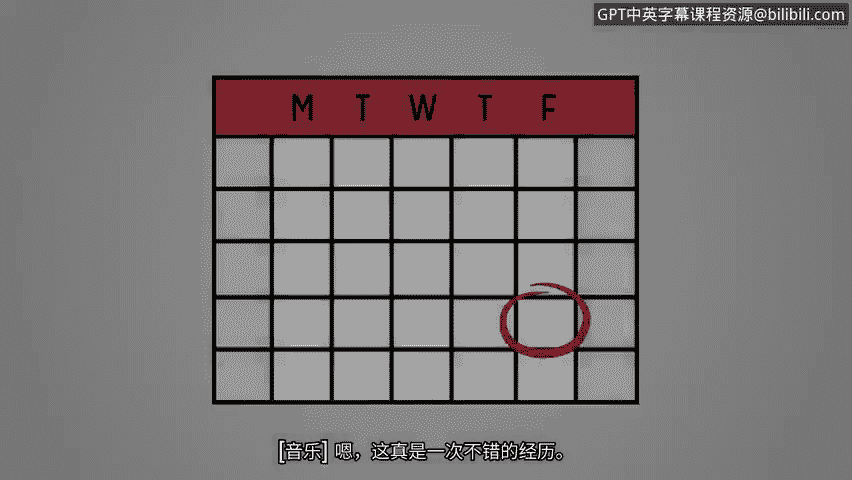

软件产品管理：6.7：视频模拟项目回顾 🎬

在本节课中，我们将回顾一个软件产品管理毕业项目的模拟视频内容，学习如何进行项目回顾会议，并总结团队协作的经验与教训。

---

上一节我们介绍了项目交付的流程，本节中我们来看看如何对已完成的项目进行系统性的回顾与总结。

项目回顾会议是团队在项目结束后，共同反思过程、庆祝成功并识别改进机会的重要活动。与冲刺回顾不同，它着眼于整个项目的生命周期。

这段旅程相当精彩，我希望大家都乐在其中。现在，我想进行一次项目回顾。

我知道我们过去进行过冲刺回顾。

但你们中有多少人参与过项目回顾？我没有。我听说过，但从未参与过。

好的，正如我们刚刚被巧妙告知的那样，如果没有团队每位成员的辛勤工作，这个项目就不可能完成。

我个人只想说，能与你们所有人共事，我感到非常自豪。

好的，任何项目回顾的第一步都是确保每个人都能轻松地公开谈论自己的想法。

因此，我想先进行一次快速的匿名投票。请在一张纸上写下1到5之间的一个数字。

这个数字代表你在此次会议中参与公开对话的安全感。

**1** 表示你感到非常不适，**5** 表示你感到非常自在。

好的，这很棒。我本以为不会有什么问题。

确实没有人给出低于4的分数，当然我对此也毫不怀疑。那么我们继续。

大家都带来了自己的“纪念物”吗？

那么，我们如何处理这些纪念物呢？我希望每个人谈谈哪件纪念物对他们意义最大。

乔希，你想开始吗？好的，我带来了一张截图，是我打印出来的一张屏幕截图。

这是我单元测试失败的截图。

这是我第一次测试失败时截的，当时我以为测试不会失败。

我喜欢它，因为它是一个很好的提醒：我的代码并非总是完美的，单元测试也很重要。

即使它们会占用更多时间。哦，我还带来了一罐Alexa给我买的杀虫剂，是个玩笑。

很棒的选择，乔希。好的，我下一个来。我带来了这张有人留在我桌上的便利贴。

上面写着“今天干得不错，继续加油”。我不知道是谁写的，所以别告诉我，因为我有点喜欢不知道的感觉。是的，它帮我度过了一个有点艰难的日子。

被欣赏的感觉很好。所以，谢谢写这张便条的人。太好了，和你共事真的很愉快。

我当然也带了东西。

我带来了我们项目的燃尽图。我认为我们共同完成的工作量是惊人的，我想提醒大家这一点。

我还带来了一本儿童书，是我们为Candata项目使用的那本的实体版，我特意出去买的。

但它是这个项目的纪念品，希望未来能将这样的书籍带给全世界值得拥有的孩子们。

太完美了。谢谢。也许之后，我们可以团队一起和我们的纪念物拍张照。是的，好主意。太棒了。

那么，让我们再多谈谈这个项目。它成功吗？我不知道。

我们完成了所有应该完成的任务。

但我只是希望我们能继续做下去。我觉得我们没有打造出我们所能打造的最好的产品。

我明白你的意思，但你必须记住，我们在专注于重要事项和按时交付方面确实做得很好。

是的，而且我们必须在仅仅几个冲刺内为贸易展交付一些东西。

在这么短的时间里，你不能指望完成太多工作。你说的没错。我们本可以做得更多。

乔希，你怎么看？实际上，我觉得相当不错。

我的意思是，确实没发生什么大事。那么，好吧，下一个练习是构建我们的项目时间线。

考虑到项目周期很短，这应该相当简单。我们每个人在便利贴上写下一个事件，然后贴在这张纸上，接着写下其他重要事件也贴上去。

那么，我来从项目开始、我们所有人开始一起工作时写起。

所以第一个主要事件应该是我们开始构建应用程序的时候，对吧？

我认为我们应该先写下需求分析过程，我觉得我们可以把两者都写下来。这是一个协作的过程。

完美，好的，让我们思考一下这个时间线。我们可爱的产品经理给了我们一些讨论主题。那么我们来谈谈它们。

我们哪些方面做得很好。我们的流程，我认为我们很好地遵循了敏捷实践。

确实如此。

我认为我们作为一个团队合作得非常好。

而且归根结底，我们的沟通也相当不错。好的，还有其他吗？没有了，好的。

我们学到了什么。我学到了编写测试用例并不真的那么难。

我学到了，不先与大家沟通就按自己认为对的方式去做是不好的。

好的，非常好。你们俩呢？我学到了Scrum可以成功地用于小型项目。我还学到了我在团队中工作得比我想象的要好。还有其他吗？没有。好的，我们继续吧。

下次你会有什么不同的做法？伙计们，你们太棒了，知道吗？这真是很多东西。

哇，我们在这个项目中确实做了很多，不是吗？好了，差不多就这些了。

我认为没有其他需要讨论的了。你们能想到什么吗？

不，我想不到。好的，那么。

这次很有趣。我们和所有这些东西拍张照怎么样？然后我可以马上发给你们。

太棒了，谢谢你们和我一起做这件事。

---

本节课中我们一起学习了如何进行项目回顾会议。关键步骤包括：营造安全的发言环境、分享有意义的项目纪念物、评估项目成功与否、构建项目时间线，并系统讨论“哪些做得好”、“学到了什么”以及“下次如何改进”。这有助于团队巩固经验，持续提升协作与产品开发能力。