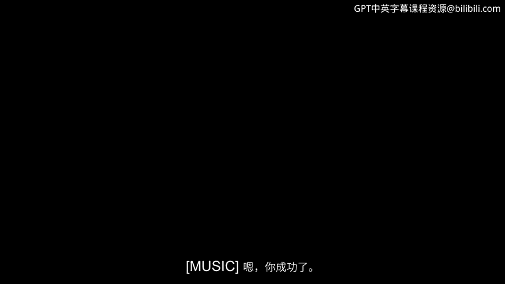
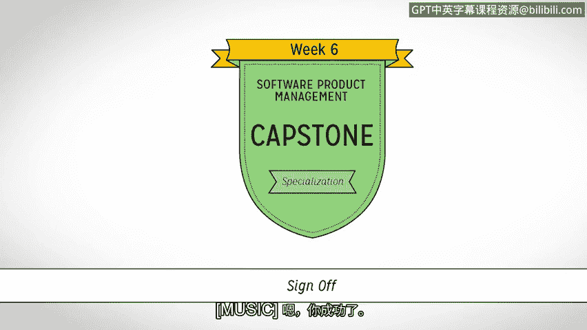
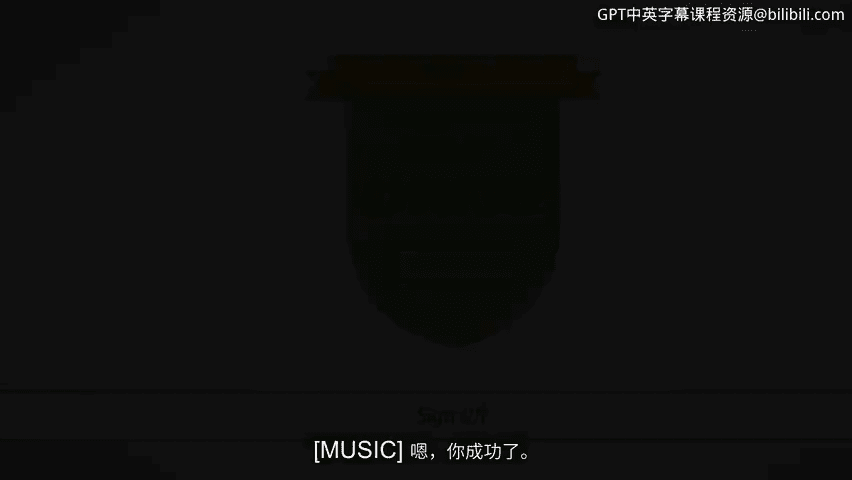

软件产品管理：6.10：恭喜您完成毕业设计项目 🎉

在本节中，我们将共同回顾您在专项课程中的旅程，并对您的成就表示祝贺。

您成功了，祝贺您。阿尔伯塔大学的我们为您在此专项课程中付出的辛勤努力感到无比自豪。

我们希望您能将所学知识应用于职业生涯的任何阶段。

我们珍视每一份论坛帖子和电子邮件，与您共度的这段旅程非常精彩，我们感谢您的投入与坚持。

我们非常荣幸能为您制作这些课程，并希望您在学习过程中同样享受其中。

我们祝愿您在未来的所有努力中都能获得最好的运气。

因此，请随时与我们分享此专项课程将您带向了何方。

谢谢您，并再次祝贺。

在本节课中，我们一起完成了软件产品管理专项课程的最终环节。您已成功掌握了从产品战略规划到市场发布的完整知识体系，并完成了毕业设计项目。请带着这些宝贵的技能与信心，在未来的职业道路上继续前行。再次恭喜您顺利毕业！