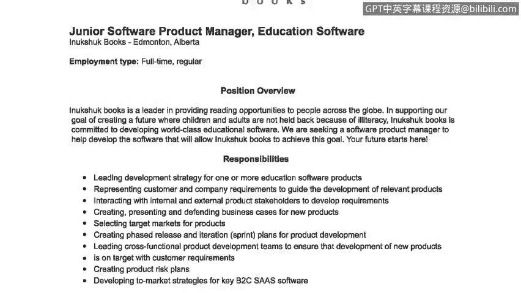
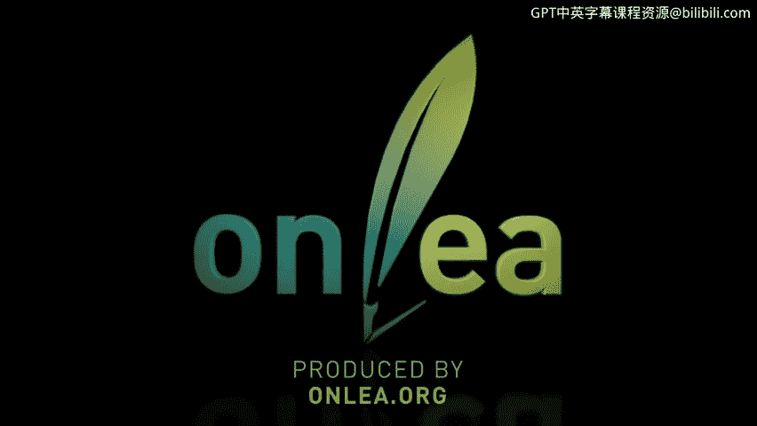

# 025：《软件产品管理毕业项目》🎓

在本节课中，我们将预览《软件产品管理》课程的毕业项目。该项目旨在整合并应用你在整个课程中学到的所有核心概念与技能，通过一个实践项目来展示你的综合能力。

## 项目概述

毕业项目是你将所学知识付诸实践的机会。你将扮演产品经理的角色，负责一个软件产品从构思到发布的完整生命周期。

上一节我们介绍了课程的整体结构，本节中我们来看看毕业项目的具体内容与目标。

## 项目核心目标

本毕业项目旨在达成以下三个核心目标：

以下是项目希望帮助你实现的关键成果：

1.  **整合课程知识**：将分散在课程各模块中的概念，如市场分析、路线图规划、敏捷开发等，系统性地应用于一个连贯的项目中。
2.  **构建作品集**：完成一个可以作为你个人作品集核心内容的项目，向潜在雇主展示你的产品管理能力。
3.  **模拟真实工作**：体验软件产品经理在真实工作环境中的职责、挑战与决策过程。

## 你将完成的任务

为了达成上述目标，你需要在项目中完成一系列具体任务。


以下是项目包含的主要阶段与活动：

*   **产品构思与验证**：识别一个市场机会，定义产品愿景，并通过用户调研或市场分析验证其可行性。
*   **制定产品路线图**：规划产品的长期发展蓝图，确定不同版本（如MVP、V1.0、V2.0）的核心功能与发布节奏。
*   **创建用户故事与待办列表**：将产品功能分解为具体的用户故事，并管理产品待办事项列表。例如：
    ```markdown
    - 作为[用户角色]，我希望[达成某个目标]，以便[获得某种价值]。
    ```
*   **规划发布与迭代**：使用敏捷框架（如Scrum）规划发布周期和冲刺（Sprint），定义每次迭代的目标与交付物。
*   **撰写发布公告**：模拟产品发布，撰写面向用户或利益相关者的发布公告，阐述新版本的价值与功能。

## 项目交付成果

你的学习成果将通过一系列具体的交付物来体现。



以下是项目结束时你需要提交的核心文件：

1.  **产品需求文档**：包含产品愿景、目标用户、核心功能列表与优先级。
2.  **产品路线图**：以时间线或表格形式展示的产品发展计划。
3.  **产品待办列表**：包含已排好优先级的用户故事列表。
4.  **发布计划**：至少两个冲刺（Sprint）的详细计划，包括冲刺目标和任务分解。
5.  **最终演示**：一个简短的演示或报告，总结你的产品、所做的决策以及学到的经验。

## 成功的关键

要出色地完成这个项目，请牢记以下几点建议。



以下是帮助你顺利推进项目的几个要点：

*   **从简单开始**：你的第一个产品想法不必过于复杂。一个清晰、能解决特定用户痛点的简单想法，比一个庞大而模糊的概念更容易成功。
*   **应用课程框架**：充分利用课程中提供的模板、检查清单和思考框架来构建你的项目。
*   **寻求反馈**：如果可能，与同学、导师或朋友讨论你的想法和方案，他们的反馈极具价值。
*   **享受过程**：这是一个将理论转化为实践的安全环境。勇于尝试，并从决策中学习。

---

本节课中我们一起学习了《软件产品管理》毕业项目的整体预览。我们明确了项目的三大核心目标，了解了需要完成的具体任务和最终交付成果，并掌握了成功完成项目的关键建议。这个项目是你整合知识、构建作品集的关键一步，请做好准备，将你的产品管理技能付诸实践。