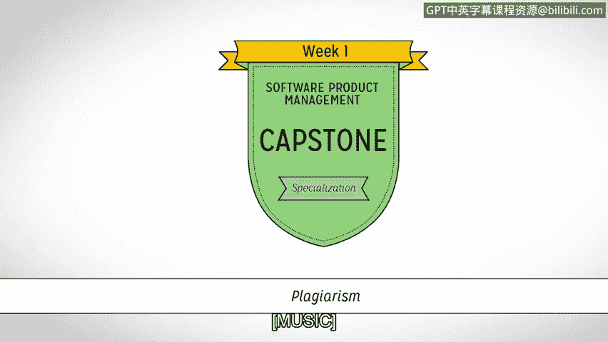

# 027：学术诚信与抄袭防范

在本节课中，我们将学习学术诚信的核心概念，明确什么是抄袭，并了解在课程作业中如何避免此类行为。这对于确保你提交的作业代表自己的原创工作至关重要。

---

## 什么是抄袭？

根据课程荣誉准则，**抄袭**是指你在未注明出处的情况下，复制他人作品中的文字、观点或任何其他材料。

抄袭在任何学术环境中都是不可接受的，它严重违反了课程的荣誉准则。抄袭可能导致作业不及格、被取消课程资格，甚至被 Coursera 社区除名。

## 抄袭的具体表现有哪些？

以下是几种常见的抄袭行为示例。

**复制粘贴他人文字**
如果你复制粘贴了他人撰写的文字，这将被视为抄袭，除非你以恰当的方式注明出处。即使你调整了语序或替换了特定词语，你仍然必须为其工作成果署名。例如，在作业、测验或讨论论坛中，复制粘贴其他学员或工作人员的文字，并将其作为自己的成果提交，是严格禁止的。

**提交他人创建的文件**
在本专项课程的某些课程中，你可能会被要求提交图片或图表作为作业。提交由其他学员创建或提交的图片，并将其作为自己的成果，同样被视为抄袭并被禁止。

**窃取观点**
某些作业可能需要一些创造性。窃取他人的创意观点被视为抄袭，即使提交的文件是由你自己创建的。在学术或商业环境中，两个或更多人可能产生相同的想法是常见现象。为了保护自己不被指控抄袭（不仅在本课程中，在你的职业生涯中也是如此），记录你的修订过程或以某种方式记录你的思考过程是一个好习惯。你可以考虑维护一个日志，记录每个想法或概念的起源时间。

## 如何维护学术诚信？

请确保在整个专项课程中提交的都是你自己的原创工作。如果你在课程中发现抄袭行为，请标记相关作业并提请课程工作人员注意。

---

本节课中，我们一起学习了抄袭的定义、具体表现形式以及维护学术诚信的重要性。请始终牢记提交原创作品的原则，并在整个学习过程中实践这些准则。