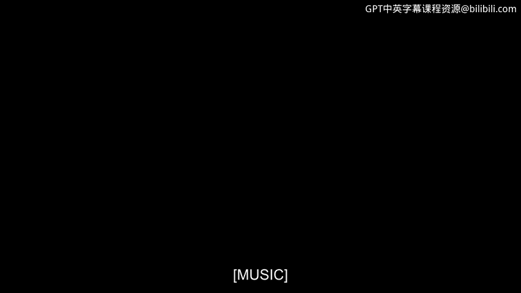

# 028：模拟开发团队介绍（周一）👥

在本节课中，我们将通过一个模拟场景，认识一个虚拟的软件开发团队成员。了解团队成员的背景、性格和工作风格，对于理解后续的团队协作与产品开发过程至关重要。

---

## 团队成员介绍

以下是团队成员的自我介绍，让我们逐一认识他们。

### 凯瑟琳 (Kathleen)

大家好，我是凯瑟琳，但请叫我凯特，凯瑟琳太正式了。我在这个行业工作了很久。在我的职业生涯中，我很幸运地从许多不同的角度体验了软件开发。我最初是一名开发者，但也担任过Scrum Master、产品负责人和Scrum教练。但我确实怀念创造的过程。我喜欢与其他团队合作并激励他们做得更好，但我非常怀念编程所带来的创造性表达。所以几年前，我回到了开发岗位。

我是一名热心的瑜伽爱好者，大多数晚上我都会在几个街区外一个很棒的小工作室练习瑜伽。如果你们有人想加入我，随时欢迎。我发现瑜伽对创造生活平衡非常有帮助。实际上，我认为这会是一次很好的团队建设活动。我们可以一起去上一节课。我认为这会使我们在精神和心灵上成为一个更强大的团队。

以上就是我的介绍。我真的很期待了解大家，并一起创造一些出色的东西。艾丽克莎，接下来请你介绍好吗？

### 艾丽克莎 (Alexa)

好的。我是艾丽克莎。我在这个行业已经工作了好几年，参与过一些很酷的项目。最近，我主要专注于视频游戏开发。是的，我离开了上一家公司，他们管得太多了。他们总是要求我记录所有的工作时间之类的。我的意思是，他们为什么不能相信我在工作呢？我写的代码比那里任何其他开发者都多。

**关于业余爱好**：哦，没什么特别的。我弹贝斯。我在一个全女子朋克乐队弹贝斯，是的，我们在本地音乐圈已经小有名气了。我还喜欢画画，喜欢设计服装。不过，我实际上没做过几件衣服，但我有很多设计图，所以也许以后会深入发展一下。

### 乔希 (Josh)

嘿，我是乔希。我干这行有段时间了。我九岁就开始编程，当时造了一个机器人去监视我的兄弟们。我懂大多数编程语言，至少是那些有用的。业余时间，我通常也在电脑前。不编程的时候，我就在写博客。我真的很喜欢游戏，最近又重新玩起了《魔兽世界》，因为《英雄联盟》我已经玩得太好了。

---

## 总结

本节课中，我们一起认识了模拟开发团队的三位核心成员：经验丰富、注重平衡与团队建设的开发者凯特；才华横溢、个性独立、热爱音乐与艺术的开发者艾丽克莎；以及技术扎实、充满热情的游戏爱好者开发者乔希。了解团队成员的不同背景和个性，是理解后续团队动态和项目管理挑战的第一步。在接下来的课程中，我们将看到这个团队如何协作并应对产品开发中的各种情况。