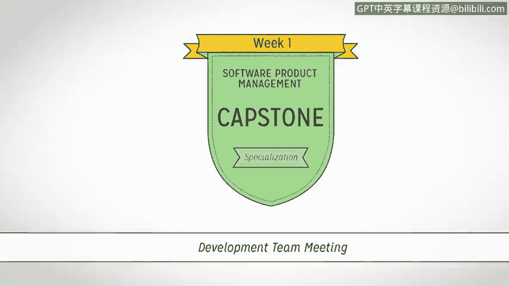

# 029：开发团队周一会议模拟

在本节中，我们将通过一个模拟的开发团队会议，学习如何将产品需求转化为具体的技术方案和设计考量。会议中，团队将讨论一个儿童阅读应用的功能实现细节。

---

## 概述

本次会议模拟了开发团队在项目初期，围绕产品经理提出的需求进行技术可行性讨论的场景。团队将逐一分析各项功能，明确技术实现路径，识别潜在挑战，并达成初步共识。

---

## 会议讨论内容

上一节我们介绍了产品需求背景，本节中我们来看看开发团队如何具体拆解这些需求。

### 核心交互功能

首先，团队讨论了应用的核心交互方式，即用户如何通过应用进行交流。

**问题：** 用户如何在应用内交流？这与普通阅读应用有何不同？能否只是一个简单的消息功能？

**讨论与结论：**
*   简单的文本消息功能违背了“为他人朗读”的初衷。
*   视频聊天会消耗大量移动数据，不适合作为主要方案。
*   **最终方案：** 设计一个**纯音频选项**作为主要交互方式，并作为视频聊天的备用方案。

### 用户账户系统

接下来，团队探讨了是否需要以及如何构建用户账户系统。

**问题：** 是否需要为“好友列表”等功能创建用户账户？

**讨论与结论：**
*   存储用户历史记录（如已读书籍）需要账户系统。
*   跟踪**每位用户的阅读理解**数据更需要独立的账户。
*   **最终方案：** 必须构建完整的账户系统，包括登录、密码重置等相关功能。

### 阅读理解评估

团队对产品经理提出的“阅读理解评估”功能的技术实现提出了疑问。

**问题：** 如何实现阅读理解的自动评估？是否必须使用语音识别？

**讨论与结论：**
*   语音识别对部分开发人员是技术挑战。
*   作为替代方案，可以考虑让用户**完成测验**。
*   **行动项：** 将此功能标记为“可做”，但在正式设计前需将其作为潜在风险提出。

### “传递共读”功能

团队分析了“传递共读”这一特色功能的具体含义。

**问题：** “传递共读”是什么？如果只是像普通电子书一样阅读，其价值何在？

**讨论与结论：**
*   必须有交互技术集成才能增加价值。
*   **技术方案：** 考虑使用**蓝牙**技术无线连接两台设备，并在每台设备上同步显示相同内容。
*   应用仍需保留单人阅读功能，作为电子阅读器使用。

### 目标设备与平台

团队明确了产品开发所针对的设备类型和操作系统。

**问题：** 产品为哪种设备（智能手机、平板电脑、网页）和平台（Android、iOS）构建？

**讨论与结论：**
*   **设备：** 为**平板电脑**设计。智能手机屏幕小，不利于阅读体验；网页应用需要Wi-Fi，不符合“便携”要求。平板电脑更能模拟书本的形态。
*   **平台：** 客户可能希望同时支持Android和iOS，但这将带来大量工作。需要与产品经理确认优先级，**希望先专注于一个平台**。

### 应用界面与体验

团队讨论了影响用户体验的界面设计细节。

**问题：** 应用应支持横屏和竖屏模式吗？是否需要页面翻页动画？

**讨论与结论：**
*   **屏幕方向：** 支持**横屏和竖屏**两种模式。
    *   横屏模式：并排显示两页。
    *   竖屏模式：单页显示，字体更大。
*   **动画效果：** 加入**页面翻页动画**以增强真实感和趣味性。团队一致认为这是个好主意。

### 内容存储与管理

团队重点讨论了如何高效管理大量的书籍内容，以平衡用户体验和设备性能。

**问题：** 如何提供书籍内容？是否将所有材料都存储在应用内？

**讨论与结论：**
以下是团队提出的内容管理方案：
1.  **在线浏览：** 从数据库拉取**书籍标题和元数据**供用户浏览，不预下载全部内容，极大节省设备存储空间。
2.  **按需下载：** 当用户开始阅读某本书时，才将该书内容存储到设备本地，避免每次阅读都访问数据库。
3.  **列表管理：** “收藏夹”和“想读”列表应**保存在设备本地**，即使用户离线也能查看和选择这些书籍。
4.  **内容删除：** 用户必须能够**从设备中删除已下载的书籍**，以管理存储空间。

### 即时词典功能

最后，团队确认了一个提升阅读体验的辅助功能。

**问题：** 是否需要内置词典？如何让儿童快速获取词义？

**讨论与结论：**
*   内置词典对儿童可能不友好。
*   **实现方案：** 采用**单词点选查词**功能。当用户（儿童或共读伙伴）点击某个单词时，定义会立即弹出显示。

---

## 总结

本节课中，我们一起学习了开发团队如何将产品需求转化为可执行的技术方案。通过这次会议模拟，我们看到团队：
1.  明确了核心功能（音频交互、账户系统）的技术实现。
2.  识别了高风险功能（语音识别评估）并制定了应对策略。
3.  确定了产品形态（平板电脑应用）和关键体验设计（双屏模式、翻页动画）。
4.  设计了高效的内容存储与管理架构（在线浏览、本地缓存）。
5.  细化了辅助功能（点选查词）的实现方式。
团队最终获得了足够的信息，可以推进到下一阶段的设计工作。