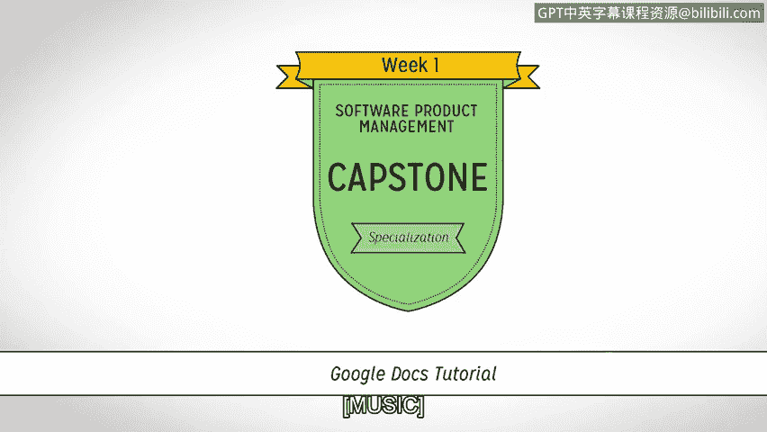
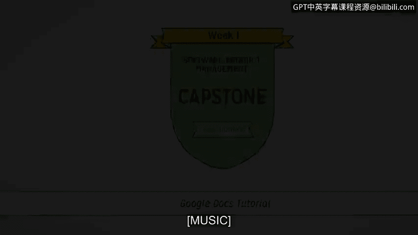
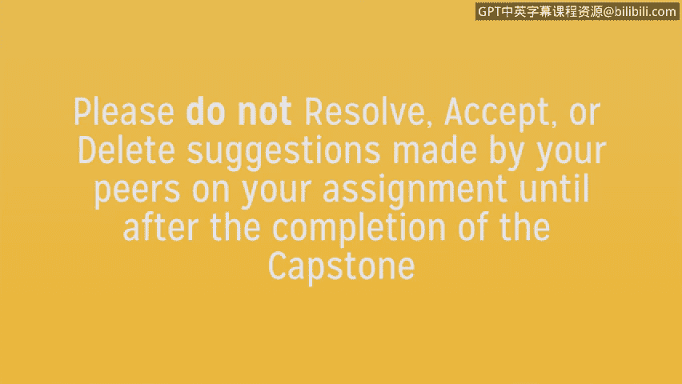

**软件产品管理毕业项目：P30：Google Docs 使用教程 📄**

在本节中，我们将学习如何在毕业项目中正确使用 Google Docs 来创建、共享和协作处理文档，特别是需求文档。掌握这些步骤对于顺利完成作业提交和同行评审至关重要。

---

### **概述**

在本教程中，我们将逐步介绍如何使用 Google Docs 来完成毕业项目中的各项任务。主要内容包括：创建 Google 账户、新建文档、重命名文档、设置共享权限以便进行同行评审，以及了解如何添加评论和建议。即使你之前使用过 Google Docs，也请完整跟随本教程，以确保掌握作业提交所必需的关键步骤。

---

### **1. 访问与创建文档**

首先，你需要一个 Google 账户。如果你还没有，请立即注册一个。

完成账户创建后，请访问 Google Docs 主页：`Docs.google.com`。

接着，点击“空白文档”选项以创建一个新文档。

创建后，你将看到如下所示的页面。

---

### **2. 命名你的文档**

你需要为文档命名。在毕业项目中，你创建的第一个 Google Docs 文档将是你的需求文档。

因此，请为其取一个恰当的名称。

重命名文档的方法是：点击页面左上角显示“未命名文档”的地方。

现在，你可以开始根据从客户和专家那里收集到的信息，创建你的需求文档了。

---

### **3. 设置文档共享权限**

下一步非常关键。Google Docs 会自动保存你的工作，但我们需要能够与同伴共享文档。

我们不希望同伴直接修改你的文档，但希望他们能够提出建议。

例如，你的同伴将在“需求技术评审”作业中评审此文档，他们需要能够添加评论。

要共享你的工作，请点击屏幕右上角的“共享”按钮。

随后会出现共享对话框。

点击“高级”以进入高级共享设置。

在高级共享设置中，点击“更改”链接。

选择“知道链接的任何人”这一选项。

**这一点很重要**：你需要将访问权限从“知道链接的任何人可查看”更改为“知道链接的任何人可评论”。

你的链接共享设置最终应如下图所示。

请仔细检查对话框，确认其显示“知道链接的任何人”可访问，且权限为“可评论”。

确认无误后，点击“保存”。这将返回到共享设置对话框。

你将使用这个生成的链接来提交作业。

现在，当你的同行评审员通过 Coursera 上的作业页面访问你的作业时，他们将能够添加建议和评论。

---

### **4. 如何进行评论与建议**

让我们了解一下评审者如何操作。

当我使用另一个 Google 账户访问该链接时，文档界面如下所示。

你会注意到绿色的“建议”模式已激活。

此时，我在文档中键入的任何内容都会以建议的形式显示。

你还可以通过以下方式添加评论：首先高亮选中想要评论的文本，然后点击此处显示的“添加评论”按钮。

**请注意**：在毕业项目全部完成之前，请不要解决、接受或删除同伴在你的作业上提出的建议。

你将在第二周的“需求技术评审”作业中，对你的同伴的需求文档进行评论。

---

### **总结**

本节课我们一起学习了在毕业项目中使用 Google Docs 的核心流程。我们涵盖了从创建文档、正确命名，到设置关键共享权限（设置为“可评论”）的每一步。此外，我们还了解了同行评审者如何进入建议模式并添加评论。正确遵循这些步骤，将确保你的作业能被顺利评审，并促进有效的协作。