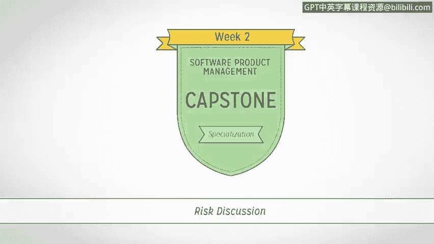

**软件产品管理毕业项目：6.1.2-3：风险讨论模拟（周三）** 🎬

在本节中，我们将通过一个团队讨论的模拟场景，学习如何识别软件项目中的潜在风险。我们将跟随一个团队的对话，了解他们如何从不同角度发现并评估项目风险。

---

### **概述**

本节课我们将模拟一个项目团队的风险讨论会。团队成员会从功能、技术、人员、外部依赖等多个方面，指出在开发一个软件产品时可能遇到的风险。通过这个案例，我们可以学习如何系统性地进行风险识别。

---

### **风险识别讨论**

上一节我们介绍了风险管理的概念，本节中我们来看看一个团队在实际讨论中如何识别具体风险。以下是团队成员提出的各类潜在风险。

**功能实现风险**
*   某些提议的功能（如**语音识别**和**远程用户连接**）在实现上可能存在风险。
*   团队需要在开发前充分评估这些功能的价值，确保其必要性。

**技术平台风险**
*   同时为 **Android** 和 **iOS** 两个平台开发会带来大量工作。
*   不同操作系统间的**兼容性问题**可能构成重大风险。

**项目干系人风险**
*   关键干系人（如产品负责人Lisa）可能经常**改变想法**。虽然她的想法通常很好，但需求频繁变更本身是一种风险。

**团队资源风险**
*   团队规模小，任何成员**生病**或无法工作都会对项目进度产生重大影响。

**外部依赖风险**
*   项目依赖的**数据库**系统近期有过更新，其当前状态未知。
*   如果该系统仍像上次使用时那样存在**故障（glitchy）**，项目将面临极高风险，甚至可能失败。

---

### **总结**

本节课中，我们一起学习了一个团队如何通过集体讨论来识别项目风险。我们看到了风险可能来源于功能复杂性、技术选择、人员变动和外部依赖等多个方面。有效的风险管理始于全面而坦诚的风险识别。在接下来的课程中，我们将探讨如何为这些已识别的风险制定应对计划。