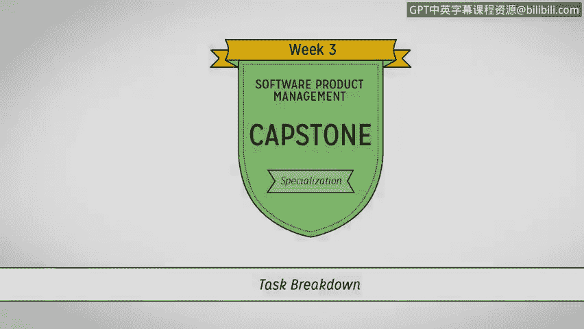

# 032：7_07_3-10-视频模拟任务分解会议

## 概述
在本节课中，我们将通过一个视频模拟会议，学习如何将用户故事分解为具体的开发任务。我们将跟随一个团队，观察他们如何讨论并确定实现某个功能所需的所有工作项，包括设计、编码、测试和文档等环节。

---

## 任务分解会议模拟

会议开始，团队准备着手处理用户故事。

### 从平板应用用户故事开始
团队决定从关于平板电脑的用户故事开始，认为这个任务相对简单。

以下是针对该用户故事识别出的任务：
*   设计应用程序的线框图。
*   搭建iOS开发环境。

### 数据库连接任务
团队确认材料数据库已经存在，无需新建。主要工作是建立与数据库的连接。

以下是针对数据库连接所需的任务：
*   设置与数据库的连接。
*   编写从数据库拉取材料的源代码。

### 确立代码审查流程
团队接下来讨论代码审查流程。有人质疑结对编程会降低效率，但最终达成共识：在特定时间进行结对编程，当有人遇到困难或需要他人检查代码时，可以请求结对。

因此，团队决定：
*   为需要单独编写的代码创建代码审查任务。
*   结对编程的代码则无需单独的审查任务。

### 确立开发与测试标准
团队决定遵循良好的编码标准，并采用测试驱动开发。

以下是为此制定的任务：
*   编写并执行单元测试。
*   编写验收标准与测试。
*   执行验收测试。

### 讨论文档需求
关于文档的必要性产生了讨论。有人引用敏捷宣言认为不需要文档，但被纠正：敏捷宣言更看重可工作的软件，而非完全不要文档。

团队最终达成一致：
*   数据库是一个复杂组件，需要内部文档来说明其工作原理。
*   由于数据库连接对用户是自动的，因此该功能不需要用户手册。

### 处理另一个用户故事
团队转向另一个用户故事，其任务分解模式变得清晰。

针对此用户故事的任务包括：
*   编写源代码。
*   审查代码。
*   编写并执行单元测试。
*   编写验收标准与测试。
*   执行验收测试。
*   为该功能设计内部文档。
*   为该功能编写用户手册。
*   进行功能设计。

---

## 总结
本节课中，我们一起观察并学习了一个团队如何将用户故事逐步分解为可执行的具体任务。这个过程涵盖了**设计**、**环境搭建**、**编码**、**代码审查**（包括结对编程）、**测试**（单元测试与验收测试）以及**文档**（内部文档与用户手册）等多个关键环节。通过模拟会议，我们看到了团队协作、标准制定（如测试驱动开发）以及对敏捷原则正确理解的重要性。团队最终确立了一套清晰的任务分解流程，并计划将其应用于后续的所有用户故事中。