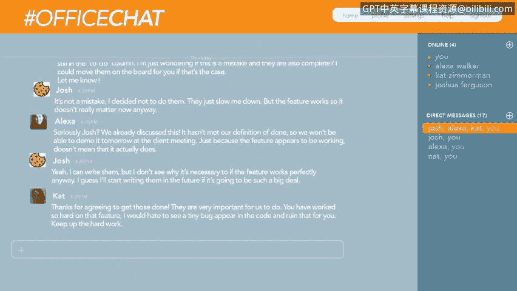

# 034：9_03_4-4-周四办公室聊天模拟对话

## 概述
在本节课中，我们将通过一个模拟的办公室聊天对话场景，来观察和体会产品经理在项目后期，特别是临近发布时，可能面临的沟通挑战与决策情境。这个场景展示了团队成员之间如何就产品功能、发布时间和用户反馈进行交流。

---

## 场景背景
上一节我们讨论了产品发布前的准备工作。本节中，我们来看看在一个典型的工作日，产品经理与开发人员之间可能发生的真实对话。这个对话发生在周四，产品计划在周五发布。

以下是模拟的办公室聊天记录，它揭示了项目后期常见的几种动态。

*   **亚历克斯（产品经理）**：嘿，团队。我刚收到一些关于新登录流程的早期用户反馈。看起来有一部分用户遇到了问题。
*   **乔丹（开发人员）**：具体是什么问题？我们的测试覆盖率很高，`login_spec.js` 单元测试全都通过了。
*   **亚历克斯**：反馈说，在密码重置后，页面重定向到了错误的仪表盘视图。这似乎是一个边缘情况。
*   **萨姆（开发人员）**：哦，那个流程。我们为了赶进度，在重定向逻辑里用了一个简单的条件判断：`if (passwordReset) { redirectTo(‘/dashboard’); }`。可能漏掉了用户角色判断。
*   **乔丹**：修复它需要修改用户会话验证和路由逻辑。我估计需要**4-6个小时**进行代码修改和回归测试。
*   **亚历克斯**：我们原定明天发布。这个问题的严重性如何？会影响多少用户？
*   **萨姆**：只有通过密码重置流程登录的用户才会遇到，比例可能小于5%。但对他们来说，这是100%的糟糕体验。
*   **亚历克斯**：我明白了。让我们评估一下选项。选项一：按原计划发布，发布后立即投入修复，作为紧急补丁。选项二：推迟发布，先修复这个缺陷。

---

## 关键决策点分析
从上面的对话中，我们可以提取出产品经理需要权衡的几个核心因素。这些因素共同构成了一个决策框架。

以下是决策时需要考虑的几个关键维度：

1.  **缺陷严重性**：该问题是否会导致数据丢失、系统崩溃，还是仅造成使用不便？
2.  **影响范围**：受影响的用户比例是多少？是全体用户还是特定子集？
3.  **修复成本**：修复所需的时间、人力和技术资源是多少？公式可以简化为：**修复成本 = 开发时间 + 测试时间 + 部署开销**。
4.  **发布压力**：是否有外部承诺（如客户合同、市场活动）或内部目标（如季度目标）要求按时发布？
5.  **用户体验与品牌风险**：发布一个有已知缺陷的产品，对用户信任和品牌声誉的潜在损害有多大？

---

## 过渡到决策
综合以上因素，产品经理需要做出一个平衡各方利益的决策。这通常没有完美答案，但必须有明确的理由。

在本次模拟场景中，亚历克斯可能会进行如下思考：
“虽然该缺陷影响面较小，但它发生在关键的登录流程中，会给受影响用户留下极差的第一印象。考虑到修复时间在可控范围内，为了确保发布质量和用户体验，我决定选择推迟一天发布，优先修复此问题。”

---

## 总结
本节课中，我们一起学习了一个产品发布前的决策模拟场景。通过分析一段真实的团队对话，我们看到了产品经理如何收集信息（用户反馈、技术评估），并基于**缺陷严重性**、**影响范围**和**修复成本**等多个维度做出是否推迟发布的艰难决定。这种在质量、时间和范围之间的权衡，是软件产品管理工作中不可或缺的一部分。