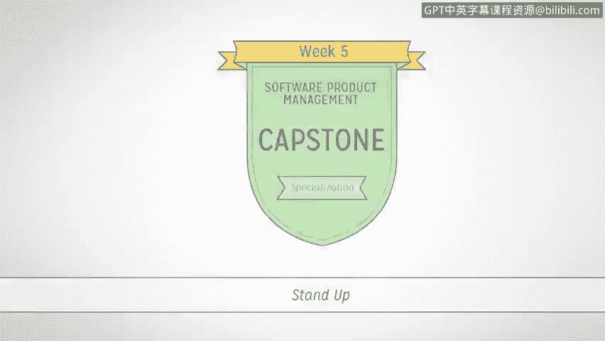

# 039：站立会议模拟（周三）

在本节课中，我们将通过一个模拟的周三站立会议场景，了解软件开发团队在冲刺阶段如何同步进度、识别障碍并协调工作。我们将重点关注团队成员之间的沟通与任务更新。

---

好的，各位，我们来看看目前的进展。

我意识到我们的进度有些落后，因为我们刚刚才把数据库连接设置好。不过值得庆幸的是，这部分工作已经全部完成，所以我们可以顺利进行了。希望从现在开始一切都能顺利运行。

是的，抱歉各位，昨天花的时间比预期长得多，但我已经完成了数据库连接，并且也编写了相关的单元测试，执行时全部通过了。希望这个连接对大家都能正常工作。

今天我将着手开发搜索功能，目前没有任何阻碍。

好的，我昨天在编写浏览和选择功能（包括书籍封面和书签）的源代码。所以我今天会继续这项工作。如果我今天能完成布局程序，那么我将开始将其与数据库连接起来。所以目前我也没有阻碍。不过，乔希，我之后在连接时可能需要你的帮助。

没问题，到时候告诉我就行。

好的。我今天将开始为“本地保存”功能编写源代码。昨天我在等待乔希完成连接时，为几个功能编写了文档。既然现在连接完成了，我就可以真正开始开发这个功能了。现在连接已完成，我没有任何阻碍，让我们开始工作吧，我们有很多进度要追赶。

---

本节课中，我们一起观察了一个软件开发团队在站立会议上的交流。会议中，团队成员同步了各自的任务进度（如完成数据库连接、编写单元测试、开发搜索与浏览功能），确认了当前没有重大阻碍，并规划了当日的重点工作。这展示了团队如何通过简短高效的每日站会来保持信息同步、解决问题并推动项目前进。