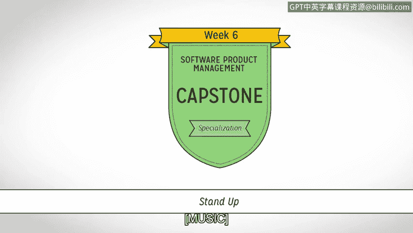
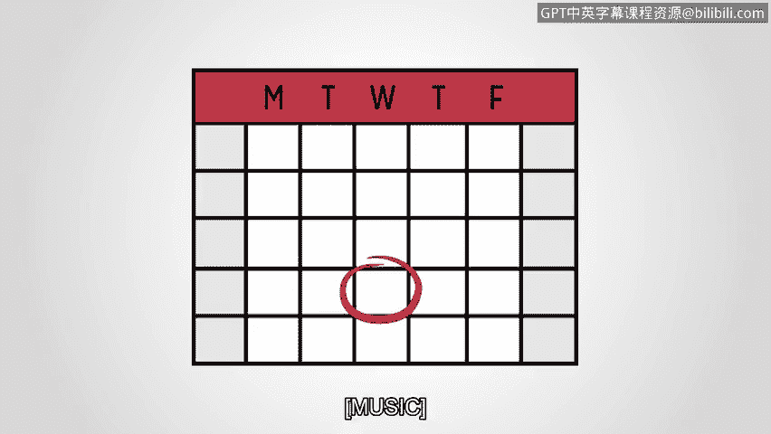

# 044：模拟站立会议（周三）

## 概述

在本节课程中，我们将通过一个模拟的周三站立会议场景，来观察一个敏捷开发团队在日常站会中如何同步工作进度、讨论问题并规划当日任务。你将了解到站会的基本流程、有效的沟通方式以及如何处理开发过程中的优先级冲突。

---

## 会议内容实录与分析

会议开始，团队成员逐一进行汇报。

以下是第一位成员的汇报：

*   **昨日完成**：完成了Daniel布置的阅读理解测验，并将其开发成了一个完整的功能。所有测试均已通过，文档也已编写完毕。
*   **今日计划**：开发基于阅读水平为远程用户进行匹配的功能。
*   **所需帮助**：希望相关账户能在其开始跟踪阅读进度改进功能前设置好，以节省时间。
*   **阻塞问题**：无。

接下来，第二位成员进行汇报。

*   **昨日完成**：完成了账户系统和登录功能，并根据Daniel的建议使登录流程对儿童更友好。开始了“单词释义”功能的开发，找到了儿童词典数据库并从Lisa处获得了必要的授权。目前实现了长按单词弹出窗口，但尚未连接释义数据。
*   **今日计划**：开始将释义数据连接到弹出的窗口。
*   **阻塞问题**：无。

随后，第三位成员开始汇报，但内容引发了关于任务优先级的讨论。

*   **昨日完成**：一直在开发浏览材料排序功能。
*   **今日计划**：原计划继续此工作。
*   **阻塞问题**：无。

此时，其他成员提出了疑问：“等等，你不是应该在做‘收藏夹’和‘待读列表’功能吗？我以为排序功能已经被砍掉了。”该成员解释说自己对排序功能有很多想法，并认为“收藏夹”和“待读列表”功能只需要很少时间就能完成。

这引出了一个关键的项目管理问题：**个人兴趣与项目优先级冲突**。另一位成员明确指出：“不，这很重要。”团队决定暂时搁置争议，提议“我们稍后再单独讨论这个问题”。

由于上述讨论，该成员调整了计划：“好吧，我昨天是在做那个（排序功能）。现在我也不太确定今天要做什么了。”

---

## 总结

本节课我们一起模拟观察了一次敏捷团队的站立会议。会议中，团队成员同步了开发进度（如“完成登录功能”、“通过所有测试”），并明确了当日任务（如“连接释义数据”）。同时，我们也看到了一个典型的团队协作挑战：当个人想继续从事被搁置的功能（**排序功能**），而团队优先级要求他转向其他任务（**收藏夹和待读列表**）时，如何妥善处理。有效的解决方式是及时识别冲突，并约定在会后进行专门讨论，以确保站会高效、聚焦。