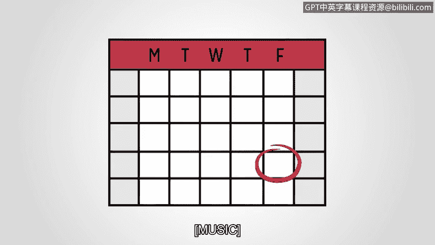

# 045：模拟站立会议（周五）🎬

在本节中，我们将通过一个模拟的周五站立会议场景，来观察一个敏捷团队如何同步工作进度、讨论障碍并规划当日任务。你将看到团队成员如何简洁地汇报工作、寻求帮助并协调任务优先级。

---

## 会议内容

以下是团队成员在站立会议中的发言记录，展示了各自的工作进展、计划及遇到的挑战。

**Josh:**
昨天，我按照Daniel的建议，将识字能力测试功能与账户创建流程连接了起来。我花了整个上午来实现这个功能。我还增加了允许用户重新参加测试的功能，以便他们可以重新评估自己的理解水平。今天，我计划编写基于水平的远程匹配功能的文档。此外，如果任何人需要，我也可以帮忙审查代码或运行验收测试。我目前没有遇到阻碍。

**Samantha:**
昨天，我基本完成了弹出式定义功能。在一天结束时我运行了单元测试，发现似乎还有一个小问题需要修复。修复之后，这个功能就可以进行验收测试了。Josh，如果你能帮我做验收测试，我将非常感激。

**Josh:**
太好了，谢谢。我是一边开发一边编写文档的，所以测试完成后，这个功能也就彻底完成了。我这边没有阻碍。

**Daniel:**
好吧，各位，我的进度严重落后了。那些列表功能花费的时间比我预想的要长得多。我在整个排序功能上花了大量时间。我想我今天只能完成其中一个列表的删除功能。这个功能已经与允许本地保存到设备的功能连接好了。我们应该先做哪个列表？

**Samantha:**
我个人认为，“待读”列表可能比“收藏夹”列表更重要。

**Josh:**
是的，我也是这么想的。你同意吗，Daniel？

**Daniel:**
同意。我应该在接下来几个小时内能完成它。另外，有人能帮我整理文档吗？我已经有很多笔记了，只是需要把它们更正式地写出来。

**Samantha:**
我可以做这个。

**Daniel:**
好的，谢谢。伙计们，我很抱歉，我感觉自己像个傻瓜。

**Josh:**
嘿，别担心。我相信完成一个列表也没问题。如果有任何我能帮忙的，请告诉我。

**Samantha:**
好了，团队，让我们把这件事完成吧。

---

## 核心实践与要点

上一节我们介绍了站立会议的基本形式，本节中我们通过具体对话看到了其实际应用。以下是本次模拟会议中体现的几个关键敏捷实践要点：

*   **进度同步**：每位成员清晰地陈述了“昨天做了什么”、“今天计划做什么”以及“遇到了什么障碍”。
*   **障碍识别与解决**：Daniel公开提出了进度延迟的问题，团队立即协作，通过**优先级讨论**（`优先完成“待读”列表`）和**任务分担**（Samantha协助整理文档）来应对。
*   **保持简洁与专注**：会议围绕任务进展展开，没有深入技术细节，符合站立会议短小精悍的原则。
*   **团队支持氛围**：当Daniel表达挫折感时，团队成员给予了鼓励和支持，这有助于维持团队士气。

---

## 总结

本节课我们一起学习并模拟了一个典型的周五站立会议。我们看到了团队成员如何通过结构化的沟通（昨日成果、今日计划、当前阻碍）来保持同步，如何协作解决优先级和资源问题，以及如何维持积极支持的团队环境。有效的站立会议是敏捷开发中确保信息透明、快速响应变化和保持团队前进动力的重要仪式。