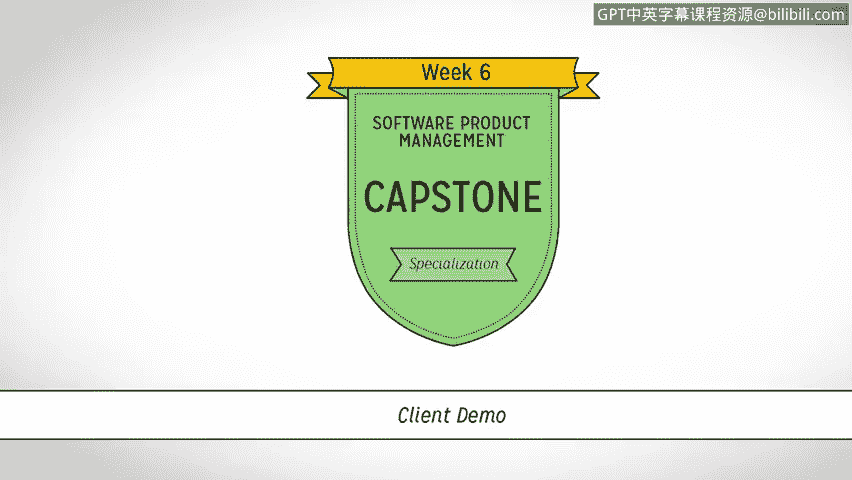

# 046：客户演示模拟

## 概述
在本节课中，我们将观看一个客户演示的模拟场景。这个演示展示了一个为儿童设计的阅读应用，涵盖了账户管理、阅读水平测试、配对功能、词典工具和书单管理等核心功能。我们将通过这个演示来了解如何向客户展示一个软件产品的核心价值与用户体验。

---

## 演示开场与账户系统

演示者首先回顾了本周的进展，并向客户展示了一款功能完善的产品。

以下是账户系统的主要功能点：

*   **家长账户创建**：家长可以通过点击按钮为自己创建账户。
*   **登录功能**：家长可以登录自己的账户。
*   **管理子账户**：登录后，家长可以看到关联到自己账户下的孩子账户列表。
*   **添加子账户**：家长可以通过点击指定按钮添加新的孩子账户。

---

## 儿童登录与阅读水平测试

上一节我们介绍了家长端的账户管理功能，本节中我们来看看儿童用户如何登录以及应用如何评估他们的阅读能力。

儿童登录过程非常简单，他们只需点击列表中自己的头像即可。如果是首次登录，系统会引导他们完成一个阅读理解测试。

以下是阅读理解测试的流程：

*   **测试内容**：儿童阅读一小段文本，并回答几个相关问题。
*   **动态调整**：如果文本对孩子来说太难或太容易，系统会根据他们的得分，将他们重定向到更难或更简单的文本段落。
*   **生成阅读等级**：最终，系统会给出一个分数，该分数直接对应孩子的阅读水平。
*   **重试机制**：儿童可以随时在主屏幕上通过按钮重新参加测试。

---

## 基于阅读水平的配对功能

在确定了儿童的阅读水平后，应用可以利用这一信息来优化社交阅读体验。

儿童可以**选择基于阅读水平进行配对**。当他们像往常一样尝试连接时，会弹出一个窗口，询问他们是否希望根据阅读水平进行配对。如果周围没有阅读水平完全相同的人，系统会将他们与分数最接近的可用用户进行配对。

---

## 内置词典与书单管理

除了核心的阅读和社交功能，应用还包含了一些提升阅读体验的实用工具。

接下来展示的是**弹出式词典功能**。当儿童在阅读任何书籍时，如果遇到不认识的单词，只需长按该单词，词典定义就会立即弹出。这是一个儿童词典，定义非常易于理解。要退出词典，只需点击弹出窗口外的区域即可。

应用还允许儿童管理自己的阅读计划。

以下是书单管理的具体操作：

*   **添加到“想读”列表**：儿童可以通过点击每本书旁边出现的星形按钮，将书籍添加到“想读”列表。
*   **本地保存**：“想读”列表中的所有书籍都会自动**本地保存**到设备上，以便他们随时随地阅读。
*   **删除项目**：可以通过点击每本书旁边的小垃圾桶按钮，从列表中删除书籍。

---

## 客户反馈与讨论

在功能演示结束后，客户团队与开发团队进行了交流，并提供了反馈。

客户首先确认了一个功能点：“**不是应该还有一个收藏夹列表吗？**” 开发团队承认这原计划中，但由于时间限制未能完成，并认为目前一个列表已经足够。客户表示同意，认为两个列表可能会让应用变得过于复杂，并称赞了当前的设计。

客户对应用的整体成果给予了高度评价，认为它将在贸易展上大获成功。他们特别赞赏了以下几点：

1.  **阅读理解测试**：认为它比人工测试方便得多。
2.  **功能的教育影响力**：相信所选择的功能将产生巨大的教育影响。
3.  **弹出式词典**：认为它能帮助孩子在阅读时顺畅地查询生词。

同时，客户也提出了一个改进建议：**可能需要一个入门教程**，来引导孩子们发现并使用这些功能。开发团队认为这是一个好主意，但可以留待后续实现。

---

## 总结
本节课中，我们一起观看并分析了一个软件产品向客户演示的完整模拟过程。我们看到了一个儿童阅读应用从账户系统、智能测试、社交配对到阅读辅助工具的全功能展示。演示不仅清晰地呈现了产品价值，还通过客户互动环节，展现了如何处理反馈、调整优先级以及规划后续改进。这体现了软件产品管理中，沟通、演示和灵活响应需求的重要性。