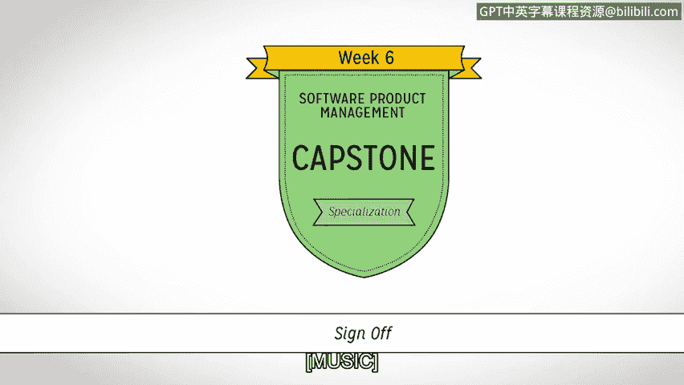
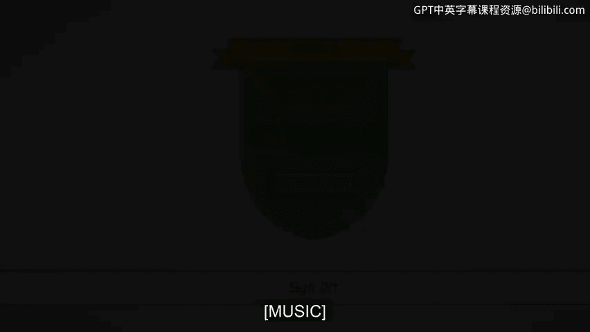

# 048：毕业祝贺与总结

在本节课中，我们将一起回顾并总结整个毕业项目的学习历程，并对未来的职业发展致以祝福。

---

你成功完成了课程，我们表示祝贺。阿尔伯塔大学为你在此专项课程中付出的辛勤努力感到无比自豪。

我们希望你能将所学知识应用于未来职业生涯的每一个阶段。

我们珍视你发布的每一条论坛帖子和发送的每一封邮件。与你共同学习的这段旅程非常精彩，我们感谢你的全心投入。

我们非常享受为你制作这些课程的过程，并希望你也同样享受学习的过程。

我们祝愿你在未来的所有努力中都能获得最好的运气。

因此，请随时告知我们此专项课程将你带向了何方。

再次感谢你，并祝贺你成功毕业。

---

本节课中我们一起学习了毕业项目的最终总结。我们回顾了整个学习旅程，强调了将知识应用于实践的重要性，并对未来的职业道路表达了美好祝愿。恭喜你完成这一重要的学习阶段。