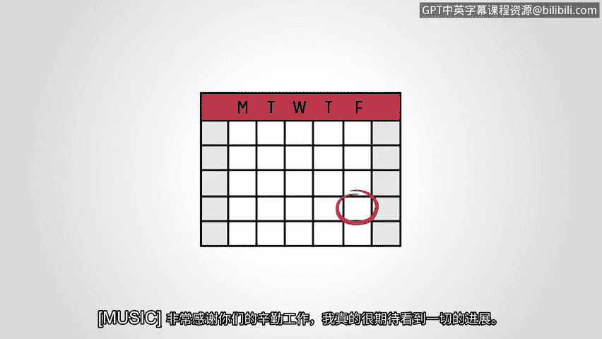

# 软件产品管理毕业项目：4.6：视频模拟客户演示与积压工作细化

在本节课中，我们将通过一个视频模拟场景，学习如何向客户演示产品功能，并根据客户反馈进行产品待办事项列表的细化。我们将重点关注如何将客户的新想法转化为具体的用户故事，并对其进行评估和优先级排序。

---

## 概述

本节课程模拟了一个产品团队向客户演示当前开发成果的场景。演示结束后，团队与客户一起讨论新的功能想法，并将这些想法转化为具体的用户故事，随后进行故事点估算和优先级排序，为下一个开发冲刺做准备。

---

## 客户演示环节

上一节我们介绍了如何准备演示，本节中我们来看看一个完整的客户演示过程。团队向客户展示了已开发的平板应用核心功能。

团队首先展示了应用的阅读界面。应用模拟了真实书籍的排版布局，并支持以下功能：
*   关联的图片会显示在页面上。
*   用户可以调整字体大小以便阅读。
*   应用支持横屏和竖屏两种模式。

接下来，团队演示了核心的音频连接功能。他们选择点对点音频连接，因为这种方案数据使用量更少，且能更好地保护儿童隐私。

演示中，用户按下连接按钮后，两台设备成功建立了音频连接，并实现了实时通话。

客户对团队的工作成果给予了积极反馈，特别肯定了音频连接功能和经过优化的浅色背景设计。

---

## 收集客户反馈与新功能建议

在演示结束后，客户提出了一些新的功能想法，希望团队能考虑加入产品路线图。

客户提出了以下三个功能建议：
1.  **文本高亮**：读者可以高亮页面上的文本。
2.  **保存高亮**：当读者退出书籍时，其高亮内容应被保存。
3.  **书签功能**：读者可以保存阅读进度。

团队与客户确认，目前资料库中尚未包含有声书资源，因此暂不考虑添加“跟随朗读”的音频功能。

---

## 积压工作细化：将想法转化为用户故事

在收集了客户的新想法后，团队立即开始了产品待办事项列表的细化工作。首先，需要将这些模糊的想法转化为格式清晰、可执行的用户故事。

团队针对每个建议，协作撰写了对应的用户故事：
*   **想法1**：转化为故事——“作为读者，我希望能够高亮书中的文本，以便记住书中的重要内容。”
*   **想法2**：转化为故事——“作为读者，我希望创建的高亮内容在退出书籍后能被保存，以便在我返回书籍时可以回顾。”
*   **想法3**：转化为故事——“作为读者，我希望我在书中的位置能被保存，以便我可以在之后回到该位置。”

---

## 评估用户故事：风险与故事点

定义了用户故事后，下一步是对它们进行评估，包括风险等级和故事点估算。

团队首先评估了风险：
*   书签功能被认为是**低风险**。
*   保存高亮功能因涉及数据持久化，复杂度较高，被评估为**中等风险**。

随后，团队使用“同时亮牌”的方法进行故事点估算，以避免相互影响：
*   **高亮文本**：一致评为 **1** 个故事点。
*   **保存高亮**：一致评为 **2** 个故事点。
*   **书签功能**：经过讨论，最终定为 **3** 个故事点。

---

## 确定下一个冲刺的优先级

最后，团队需要结合现有任务和新故事，为下一个开发冲刺确定优先级。他们列出了冲刺候选任务，并进行了激烈讨论。

以下是优先级排序的讨论要点：
*   **最高优先级**：连接数据库。这是应用的基础，必须优先完成。
*   **中等优先级**：浏览、选择和搜索功能。
*   **重要考量**：客户认为“本地保存资料”比“用户账户”功能更重要，因为它能确保用户在无网络时仍可阅读。
*   **较低优先级**：基于理解难度或类型的排序功能。

经过讨论，团队初步形成了下一个冲刺的优先级顺序，并意识到需要根据总故事点容量重新调整发布计划，可能需移除部分功能。

---

## 总结

本节课中，我们一起学习了从客户演示到积压工作细化的完整流程。我们看到了如何向客户展示成果、收集反馈，并将模糊的需求转化为具体的用户故事。接着，我们通过评估风险、估算故事点以及团队讨论，确定了功能的开发优先级。这个过程是敏捷开发中持续规划和调整的关键，确保产品始终朝着最有价值的方向演进。