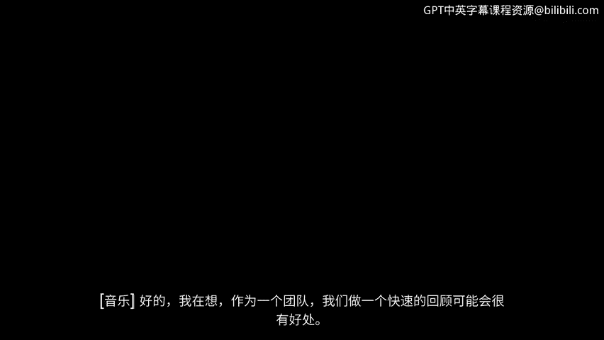
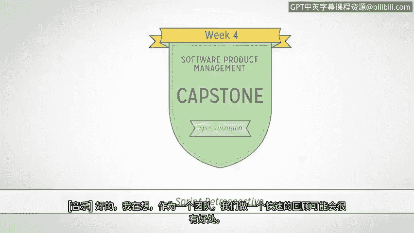

# 艾伯塔大学软件产品管理课程6：《软件产品管理毕业项目》｜software-product-management-capstone｜ - P13：12_第4.8节 视频模拟冲刺回顾 星期五.zh - GPT中英字幕课程资源 - BV1Su411T7fE

🎼。😊。

🎼不是一不。😊，🎼Okay so I was thinking it would be good for us as a team to do a quick retrospective I think we could learn a lot from this process and it could really benefit us moving forward Does that sound okay to everyone Yeah yeah I guess so great so then I think the way we should do this is we should go through and brainstorm what went well and what went wrong and then based on what we come up with then we can kind of discover some ways to help improve for the next sprint so yeah let's start with what we did well well we got all the expected user stories complete Yes we did and that was quite an achievement especially in the first sprint。

What else？We had a stand up every day。 It might not have been first thing in the morning。

 but we always found the time to get one done Yep， what else Well， in the end。

 all of our user stories met our definition of done Indeed and we have a working product Yes。

 we do and an impressive one at that Anything else。No。

 what about things that we could have done better？ Please remember that this is not an attack。

 We're just doing this so we can improve every sprint。Well。

 I guess the obvious one is that my unit tests weren't written before I started doing the source code for my feature Y。

 but I think that's an easy fix。 we also should have written our acceptance tests and criteria before we started developing It's not a big deal but it's something we can improve on Def and I think we could improve the use of the task board there were many times through the sprint where it didn't accurately represent the progress of where we were at so I just think we need to be more diligent and update the board when a task has progressed。

 That's a good point I was bad at that that's okay no worries that's what this exercises for how do we think our story point estimates were I know we got them all done on time and with little time to spare so overall they were fine but how accurate were they individually I think they were fine but probably need another sprint to know for sure Yeah I think they were pretty accurate。

Okay， so then should we add those to the positives， That's a good idea， Josh。

Does anyone have anything else？Not that I can think of。All right。

 so now let's talk about some ways that we can improve for the next sprint。

 writing acceptance tests and unit tests early。 Yep， let's add that。

Uing the task board more Of course， I think we can try to pair program a bit more。 Yeah。

 I think that's a good idea， Josh I'd like to pair programs a bit with you。

 I'd like to see how you code I think that would be helpful Yeah。

 I guess I could do that Wo I think in general we could improve communication and pair programming will help with that but。

😊，I think a team can always improve with that， so it's just something to consider Yeah I agree。

Does anyone else have anything to add？All right， well， I think this has been extremely helpful。

 I'm excited to work on the next sprint and yeah， have a good weekend everyone。

