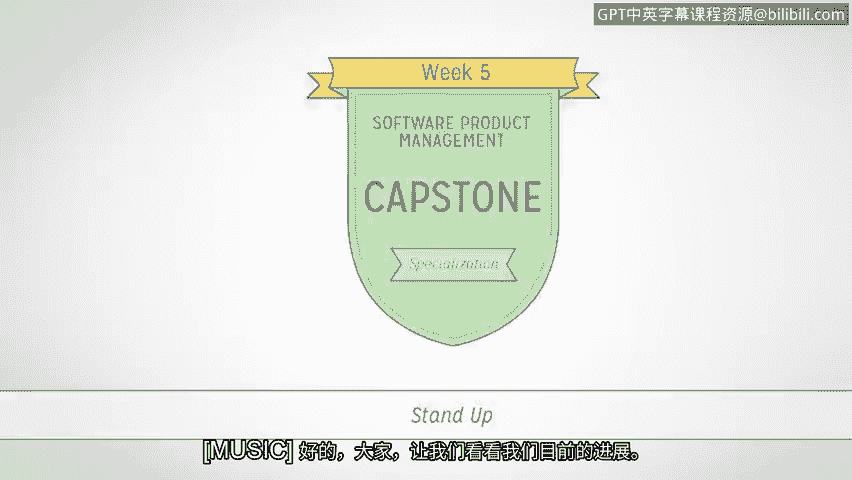

# 艾伯塔大学软件产品管理课程6：《软件产品管理毕业项目》：P15：第5.3节 视频模拟站立会议

## 概述
在本节中，我们将通过一个视频模拟的站立会议场景，来观察一个软件开发团队如何同步工作进度、讨论遇到的问题以及规划当天的任务。你将了解到敏捷开发中每日站会的实际流程与核心价值。

---

好的，各位，我们来看看目前的进展。

我意识到我们的进度有点落后，因为我们刚刚才建立好数据库连接。

不过幸运的是，这部分工作已经全部完成了，所以我们可以顺利继续。希望从现在开始一切都能顺利进行。

是的，抱歉各位，昨天建立连接花费的时间比预期长得多。但我已经完成了数据库连接，并且也编写了相关的单元测试，执行后全部通过了。希望这个连接对大家都能正常工作。

今天我将着手开发搜索功能。目前，我没有任何阻碍。

好的，昨天我一直在处理浏览和选择功能的源代码，主要是书籍封面和书签部分。所以我今天会继续这项工作。如果我今天能完成布局程序，那么我将开始将其与数据库连接起来。目前我没有任何阻碍，但是乔希，等我需要连接数据库时，我可能晚点需要你的帮助。

没问题，到时候告诉我就行。

好的。那么，我今天将开始编写本地保存功能的源代码。昨天在等待乔希完成连接时，我处理了几个功能的文档。但现在连接完成了，我可以真正开始开发这个功能了。既然连接已经完成，我也没有任何阻碍了。我们开始工作吧，我们有很多进度要追赶。

---

## 总结
本节课中，我们一起观察了一个模拟的团队站立会议。会议中，团队成员依次同步了进度：**解决了数据库连接的技术阻碍**、**明确了当天的开发任务**（如搜索功能、浏览选择功能、本地保存功能），并**提出了可能的协作需求**。这个简短的会议有效地同步了信息、清除了障碍，并帮助团队重新聚焦于项目目标，体现了敏捷开发中每日站会的核心作用。