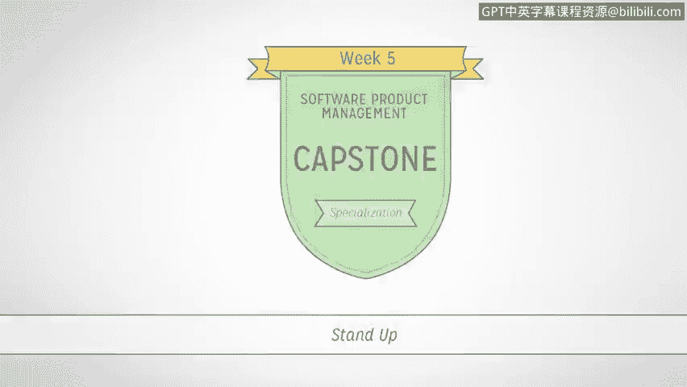
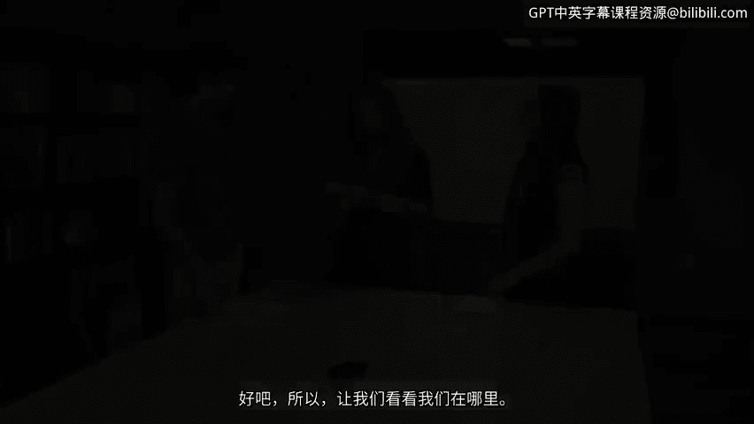

# 艾伯塔大学软件产品管理课程6：《软件产品管理毕业项目》｜software-product-management-capstone｜ - P16：15_第5.4节 视频模拟站立会议 星期五.zh - GPT中英字幕课程资源 - BV1Su411T7fE

🎼。😊。

🎼不是一不。😊，Okay， so。

Let's see where we are。 I am not sure we're gonna be 100% done in time for the demo this afternoon。

 Yesterday， I was writing the source code for the search feature。 I have a search function。

 It searches the database。But I still have to connect it to the application。

 So that's what I'm gonna to be doing all morning。 Thankly， Ka。

 you got the documentation and the acceptance test done for me， so。😊，Hopefully， it will be okay。Yeah。

 I think we'll make it。 let us know if there's anything we can do to help。

 I'm just about done the saving locally feature when I ran my unit tests at the end of the day yesterday there were a couple of errors but I don't think that they should be hard to fix so that's what I'm going to work on this morning everything else for this feature is complete so once we get the green light on these tests I'm done with this no blockers for me I finish the browse feature and the bookmarks are showing up but they're not looking great the dimensions are all off all my unit test path and I'm going to spend a little time this morning I'm just trying to make the book covers look a little better and I should also be done writing all my documentation by the meeting no blockers for me either。

Let's get to work then。