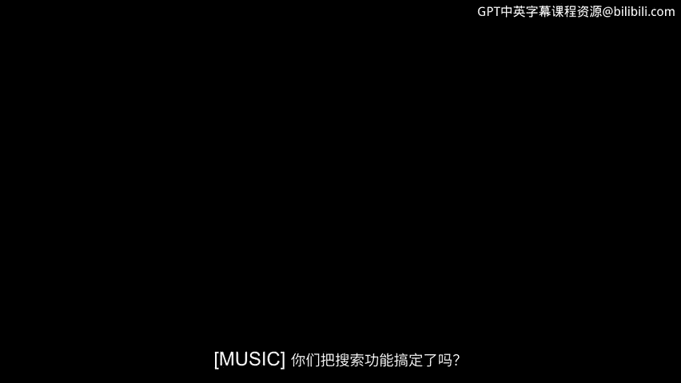
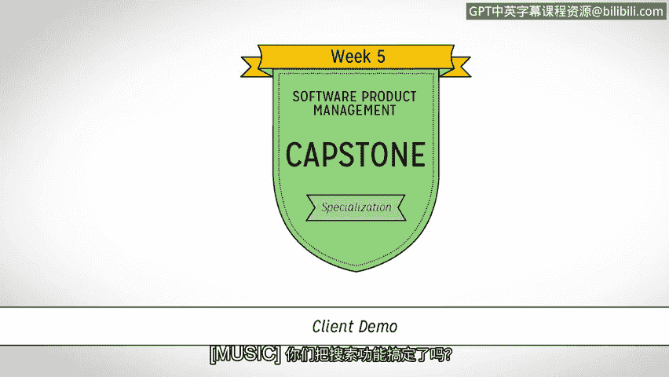

# 艾伯塔大学软件产品管理课程6：《软件产品管理毕业项目》｜software-product-management-capstone｜ - P17：16_第5.5节 视频模拟客户演示 星期五.zh - GPT中英字幕课程资源 - BV1Su411T7fE

🎼。😊。

🎼不是一不。😊，🎼。Did you get the search feature working， Are we going to demo that， Yes。

 I finished it It completely done。 All tests passed right before we got here。 Okay， perfect。

 Just checking。Hi there。 Thank you all for coming in today。

 So our product is coming together very nicely。 a lot of the core functionality is complete so this is going to be a very exciting demo。

 I'll get Alexa to start us off。😊，Yeah， so I was working on the browse feature。

 so now the user can browse all of the material from the database and they can scroll through all the books and see the covers of each book。

 and then when they decide what book that they want to read， they can select that book。

And that will bring them to the beginning of that book if they've never read it before。

 but if they have started reading that book before。

 then it now automatically saves their place and the book and brings them back to where they left off so the app now has automatic bookmarking Also the user can search for books so they can just type in whatever they want and it will narrow the results on the browse page to whatever they match to match their search the user can search for their genre。

 title， author， any keywords pertaining to those。嗯。And then。We also。

 I don't know if you have noticed this， but we have the app hooked up to the database。

 So all of that material that you provided us with will be available to them on the app with a wireless connection。

Great， so our final feature is the ability to save material locally。 So when the browser is。😊。

Or pardon me when the users browsing through material。

 there's a little save button next to each book， if the user presses that。

 then the book will save to their device and they will be able to see and read the book even without a wireless connection so let's test this out we'll choose this one。

诶。This one。Okay， now we're going to put the device into airplane mode and disconnect the wireless connection。

And then we'll go back in and。As you can see， all the books， except for the two that I selected。

 have now disappeared from the browse feature， and then you can open them and see them and read them just as normal。

So that's our demo。 Did either of you have any questions。 Oh， you guys， I am just blown away again。

 I can't believe that in just two weeks， you've accomplished all this。

Now I have some news about the future of this project， but before I get into that Daniel。

 do you have anything that youd like to say Yeah， you guys have really outdone yourselves I think a feature that could be really valuable is a page between the browser page and the actual reading page I think a reader would like to read a page with a synopsis or reviews etc cetera so they can actually decide whether or not they want to read that book。

Another thing to keep in mind is the child， the focus on the child。

 all these features are child friendly， but in the last demo you focused a lot more on the child if you need to help making any of these features more child friendly。

 please don't hesitate to contact me Yes， well we don't want to lose sight of the child user that is going to be very important。

 especially in this next sprint。Which brings me to my news。

 I may have mentioned to you a trade show in the past。

 we were trying to get into this educational trade show but couldn't get a spot。Well。

 a spot has opened up and they've offered it to us the thing is it's the week after next so we need a pretty solid prototype to demo at the next sprint well given the work that you just presented。

 I don't think that's going to be an issue but we should talk about the features that you're going to be working on next sprints。

 I think we should focus on the educational aspects of the product given the nature of the trade show。

So Daniel， are you available to stick around and help us decide which features to work on for the next sprint Yeah of course great excellent so what do you all think of this Well I think that sounds absolutely fantastic what an incredible opportunity to show off all of our hard work Yeah sounds pretty cool Yeah I agree Okay well I think it makes most sense to go back and talk about the features for the next sprint How does that sound sounds great lead the way。

