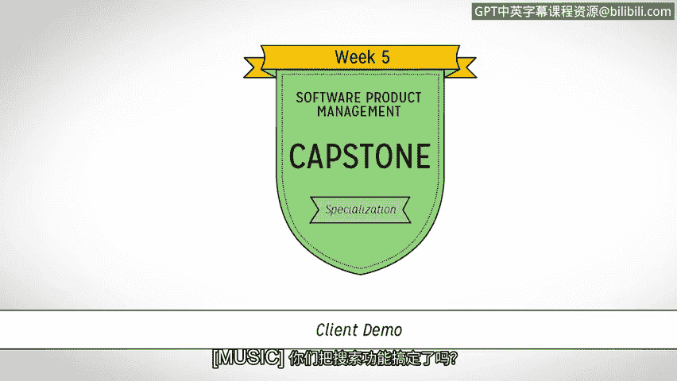

# 软件产品管理毕业项目：5.5：视频模拟客户演示

在本节课中，我们将通过一个模拟客户演示的视频，学习如何向利益相关者展示产品功能、收集反馈，并规划未来的开发冲刺。

## 概述

视频展示了一个开发团队向产品经理和客户代表演示其阅读应用新功能的场景。演示涵盖了核心功能的完成情况，并基于反馈确定了下一阶段的工作重点。

## 演示开场与功能展示

团队首先感谢与会者，并介绍产品核心功能已基本完成。

以下是本次演示展示的主要功能：

*   **浏览功能**：用户可以从数据库中浏览所有材料，滚动查看书籍封面。选择书籍后，应用会直接打开书籍。
*   **自动书签**：如果用户之前阅读过某本书，应用会自动保存阅读进度，并在下次打开时回到上次的位置。
*   **搜索功能**：用户可以通过输入**`genre`**（类型）、**`title`**（书名）、**`author`**（作者）或任何相关关键词进行搜索，浏览页面会动态筛选出匹配的结果。
*   **数据库连接**：应用已连接到数据库，用户可以通过无线网络获取所有提供的材料。
*   **本地保存功能**：用户在浏览时，可以点击每本书旁边的保存按钮。保存后，即使设备处于**`airplane mode`**（飞行模式）下断开无线连接，用户仍能查看和阅读已保存的书籍。

## 客户反馈与未来规划

演示结束后，客户代表和产品经理提供了反馈，并宣布了一个新的机会。

上一节我们介绍了已实现的功能，本节中我们来看看客户提出的建议和接下来的计划。

客户代表丹尼尔提出了两点建议：

1.  在浏览页面和阅读页面之间增加一个书籍详情页，展示简介或评论，帮助读者决定是否阅读。
2.  需要持续关注儿童用户的体验，确保所有功能对儿童友好。

随后，产品经理宣布团队获得了一个教育类贸易展览的参展机会，但时间紧迫，就在下周之后。因此，下一轮冲刺需要开发一个更完善的原型用于演示。

考虑到贸易展的性质，下一阶段的工作重点应放在产品的教育功能上。团队对此感到兴奋，并同意立即开始规划下一冲刺的功能。

## 总结

本节课中我们一起学习了如何有效地进行产品演示。关键点包括：清晰展示已完成的**核心功能**、现场测试（如离线阅读）以增强说服力、积极听取客户反馈（如增加详情页和提升儿童友好性），并能根据新的业务机会（如贸易展）快速调整后续开发优先级，将重点转向**`educational aspects`**（教育功能）。这个过程体现了产品管理中沟通、适应和持续规划的重要性。