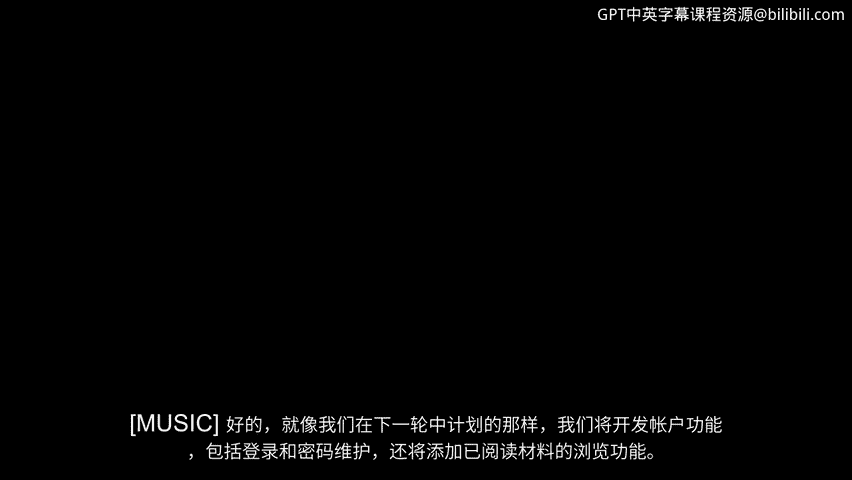
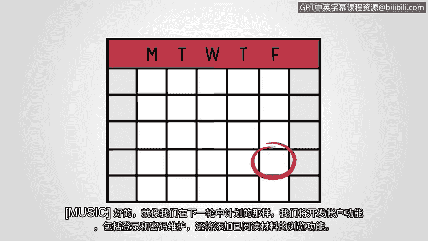

# 艾伯塔大学软件产品管理课程6：《软件产品管理毕业项目》｜software-product-management-capstone｜ - P18：17_第5.6节 视频模拟积压工作细化 星期五.zh - GPT中英字幕课程资源 - BV1Su411T7fE

🎼。😊。

🎼不是。😊，Okay， so as we had it in the next sprint， we were going to develop the account features which include logging in and password maintenance。

 and we were also going to add the feature to browse material that you've already read。

We were also going to add a favorites list and a to read list and a pop up definition tool。

 And then we were going to add a friends list and the ability to connect with friends。 Plus。

 there was that sort feature that got scoped out of the last sprint。 Oh right， That too。😊。

So many of these features have a cool functionality for the product。

 but I don't think they're going to have the biggest educational impact you know the peer to peer reading is going to be huge but we need more。

I think that the definition tool is a must for the next sprint。

 and I'd also like to see that reading comprehension tool that I originally suggested be implemented。

Yeah， I like the sound of that Now what features would go along with comprehension testing Well。

 the comprehension testing features were previously low priority。

 but we can definitely bring them back up to match our new focus the features relating to comprehension levels where the ability to have fluency and reading compresion levels tested so you could then have materials suggested to you based on comprehension on your comprehension level and the app could track reading comprehension improvements and the improvements could be tracked by voice recognition and are those features you think you'd be able to complete。

Honestly， I don't think that we could do voice recognition。

 I think it would be too hard to implement it in a week。

 like to program what sounds and pace to recognize would not only require a ton of research。

 but also a lot of programming。All the other features are totally doable， though， Yeah， I agree。

But then how are we going to track reading comprehension levels unless Daniel。

 is there already a reading comprehension test that we could use as a feature。

 there's one I have in mind that's a combination of written and multiple choice it's based on a text that's standard for reading comprehension testing。

Otherwise， reading faculty is pretty hard to test without listening to a reader。Okay， then perfect。

 I think that we should implement the multiple choice and the written test。

But then what features are we going to have to get rid of So if we add the features to test comprehension。

Provide suggestions based on reading level， track improvements and match users based on reading level。

 then。That is 11 story points worth of work that we will have to remove from our current plan for Sprint3。

 I'm thinking of getting rid of the browsing materials that were previously read and connecting with friends and friend lists。

 and that should free up。8 story points。 Yes， yeah， I agree。Wait。

 does the reading material already have corresponding difficulty levels that we can use to match material based on their reading comprehension levels No。

 it doesn't， And I don't think we'll be able to complete that feature by this sprint。 Fairair enough。

 I will make a note to look into getting that info for the database for future its。Okay， well。

 we are one story point over right now， so we'll have to cut one of the stories。

What about resetting the password， I don't think that's necessary for the trade show。 Yeah， I agree。

 That sounds fine to me。 Wait， what about that sorting feature that we scoped out last sprint。

Is that something we're still going to create？I don't think we really need it。

 I would rather get the other stuff done。man， I was really looking forward to creating that Okay。

 so we're going to do the accounts， the two read list， the favorites list。

 pop up dictionary and the reading comprehension testing and match。😊。

I think that sounds wonderful What do you think Daniel I agree I think we've got some great educational features as well as some other cool functionalities I'll send you that comprehension testing and I can stop by if you need help with it or you can call or email me any time。

😊，Well， team， I can't wait to see what this looks like。 He got the great horse。Yeah。

 I'll see you later。喂。