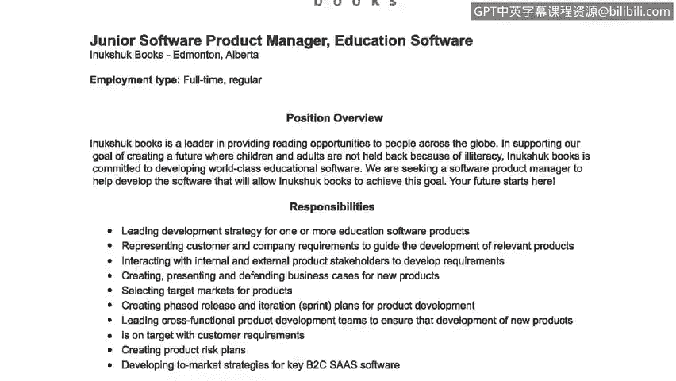
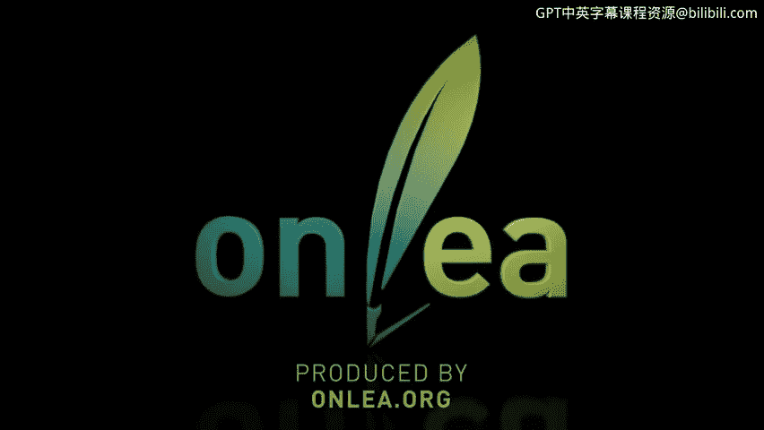

# 软件产品管理：6.0：毕业设计项目预告 🎓

在本节课中，我们将对《软件产品管理》课程的毕业设计项目进行预告。我们将了解项目的整体目标、核心任务以及它如何帮助我们整合并应用之前所学的全部知识。

毕业设计项目是本课程的最终实践环节。它旨在模拟一个真实的软件产品管理环境，要求我们综合运用从市场分析到产品发布的全套技能。

上一节我们完成了所有核心知识模块的学习，本节中我们来看看如何将这些知识付诸实践。

## 项目目标与核心任务

本毕业项目的核心目标是创建一个完整的产品方案。你需要扮演产品经理的角色，带领一个虚拟团队，将一个产品创意从概念阶段推进到发布准备阶段。

以下是项目要求你完成的核心任务列表：
*   **定义产品愿景与策略**：明确产品要解决的核心问题、目标用户以及长期发展方向。
*   **进行市场与用户研究**：分析竞争对手，识别市场机会，并通过用户画像和场景理解目标用户。
*   **制定产品路线图**：规划产品功能发布的先后顺序和时间框架。
*   **创建产品需求文档**：详细描述产品功能，优先级排序可以使用公式 **优先级 = (价值 + 紧急性) / 努力度** 进行量化评估。
*   **设计产品指标与发布计划**：定义衡量产品成功的关键指标，并规划产品发布的具体步骤。

## 你将如何完成项目

项目被设计为一系列结构化的步骤。你将跟随指导，逐步交付每个阶段的成果。

以下是项目完成的主要阶段：
*   **第一阶段：产品构思与规划**：提交产品创意、愿景声明和初步市场分析。
*   **第二阶段：需求细化与设计**：完成详细的需求文档、用户故事和产品原型设计。
*   **第三阶段：规划与交付**：制定最终的产品路线图、发布计划和成功指标评估方案。

在整个过程中，你将得到详细的说明、模板和评估标准。这就像在真实工作中一样，你需要清晰、有逻辑地展示你的决策过程和最终方案。

## 项目价值

完成这个项目，意味着你不仅学习了软件产品管理的理论，更具备了将理论应用于实践的能力。它是对你所学知识的最终检验和整合。

本节课中我们一起学习了毕业设计项目的概览。我们了解了项目的总体目标、需要完成的核心任务以及大致的执行流程。从下一节课开始，我们将正式进入项目第一阶段，开始将你的产品创意转化为具体的计划。准备好迎接挑战，创建你的第一个产品方案吧！