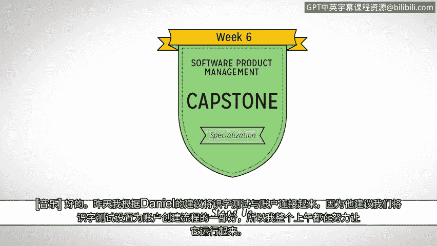
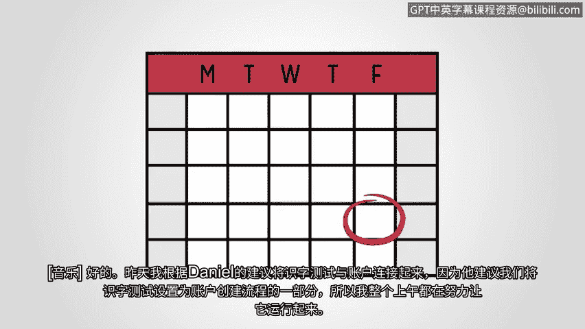

# 艾伯塔大学软件产品管理课程6：《软件产品管理毕业项目》｜software-product-management-capstone｜ - P21：20_第6.3节 视频模拟站立会议 星期五.zh - GPT中英字幕课程资源 - BV1Su411T7fE

🎼。😊。

🎼不是一不。😊，Okay so yesterday I connected the literacy testing to the accounts because Daniel suggested that we set up literacy testing as part of the account creation process so I worked all morning to get that up and running I also made it so that they can keep retaking the test in case they want to retest their comprehension level today I'm going to be writing the documentation for the remote matching based on level but I can also review any code or run any acceptance tests if anyone needs no blockers for me great yesterday I got the pop-up definition feature working for the most part I ran the unit test at the end of the day and there seemed to be one small issue so I'm going to fix that and then the feature is ready for acceptance testing I would really appreciate if you could do that for me Josh awesome thanks so I was writing documentation as I went so after the tests are done so is the feature。

No blockers for me。Okay， you guys， I'm really behind。

 Those lists are taking me a lot longer than I thought they would。

 and I spent a lot of time on that whole sort thing。

I think I'm only going to be able to get one of the lists done today with the delete feature。

 it's already hooked up to the feature that allows you to save locally to the device。

 which list should we do。I would say that the to read is probably more important than the favorites personally。

 Yeah， that's what I was thinking too。 Do you agree。Okay。

 I should be able to get that done within the next couple hours because someone help me with the docs I already have a lot of notes I just need them written out a little more formally。

 I can do that Okay thank you I'm sorry you guys， I feel like an idiot Hey， don't worry。

 I'm sure one list will be fine and let me know if there's anything I can do to help okay。

Let's get this done， team。