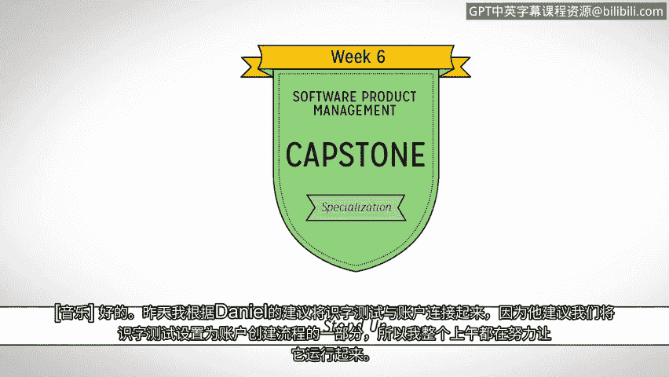
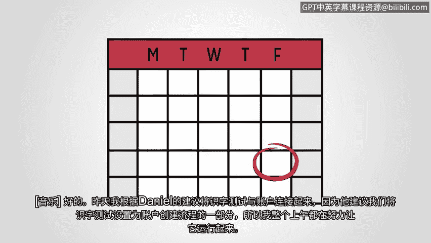

# 软件产品管理毕业项目：6.3：视频模拟站立会议

## 概述

在本节中，我们将通过一个视频模拟的站立会议场景，来学习敏捷开发中每日站会的实际流程和沟通要点。你将看到团队成员如何汇报工作进展、提出困难并协调下一步行动。

---

## 会议内容回顾

上一节我们介绍了站立会议的基本概念。本节中，我们来看看一个具体的会议模拟。

以下是会议中每位成员的发言记录：

**艾米**：昨天我将识字测试功能与账户系统进行了连接。因为丹尼尔建议我们将识字测试设置为账户创建流程的一部分。我整个上午都在努力实现这个功能。我还修改了功能，允许用户重新参加测试，以便他们可以重新评估自己的理解水平。今天我将撰写基于水平的远程匹配功能的文档。如果任何人需要，我也可以审查代码或运行验收测试。我目前没有遇到阻碍。

**乔希**：我这边也没有阻碍。昨天我基本完成了弹出式定义功能。在一天结束时我运行了单元测试，发现似乎有一个小问题。我打算修复它，然后这个功能就可以进行验收测试了。艾米，如果你能帮我做验收测试，我将非常感激。

**艾米**：没问题，谢谢。我是一边开发一边写文档的，所以测试完成后，这个功能也就完成了。

**萨姆**：好吧，各位，我进度严重落后了。那些列表功能花费的时间比我预想的要长得多。我在整个排序功能上花费了大量时间。我想我今天只能完成其中一个列表的删除功能。它已经连接到允许本地保存到设备的功能上了。我们应该先完成哪个列表？

**艾米**：我个人认为，“待阅读”列表可能比“收藏夹”列表更重要。

**乔希**：我也是这么想的。你同意吗，萨姆？

**萨姆**：同意。我应该在接下来的几个小时内能完成它。有人能帮我整理文档吗？我已经有很多笔记了，只是需要把它们写得更正式一些。

**艾米**：我可以做这个。

**萨姆**：好的，谢谢。各位，我很抱歉，我感觉自己像个傻瓜。

**乔希**：嘿，别担心。我相信完成一个列表也没问题。如果有什么我能帮忙的，请告诉我。

**艾米**：好了，团队，让我们完成这些工作吧。

---

## 核心实践解析

在模拟会议中，团队成员遵循了站立会议的核心结构。每个成员的发言都大致包含三个部分，这可以用一个简单的**公式**来描述：

**昨日完成 + 今日计划 + 遇到的阻碍**

例如，艾米的汇报可以分解为：
*   **昨日完成**：连接了识字测试与账户系统。
*   **今日计划**：撰写远程匹配功能的文档。
*   **遇到的阻碍**：无。

这种结构确保了沟通高效且信息聚焦。

---

## 总结

本节课中，我们一起学习了一个模拟的敏捷站立会议。我们看到了团队成员如何清晰地汇报进度（如“我完成了Y功能”）、规划当日工作（如“今天我将做X”）以及透明地提出困难（如“我进度落后了”）。会议最终以协调互助和鼓舞士气结束，体现了团队协作的精神。掌握这种沟通模式，对于有效参与敏捷项目管理至关重要。