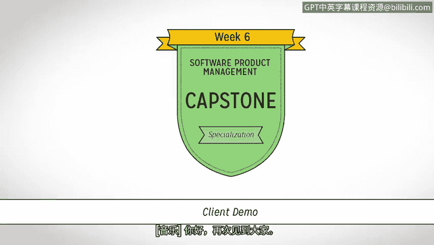
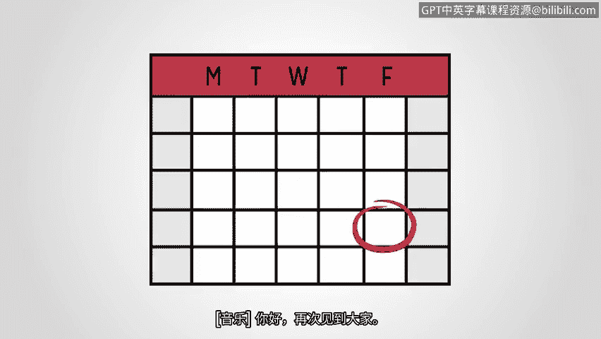

# 艾伯塔大学软件产品管理课程6：《软件产品管理毕业项目》｜software-product-management-capstone｜ - P22：21_第6.4节 视频模拟客户演示 星期五.zh - GPT中英字幕课程资源 - BV1Su411T7fE

🎼。😊。

🎼不是一不。😊，Hello again we've made some great strides this week and we've got an awesome product for you we have accounts and the first page looks like this。

So a parent can create an account for themselves by tapping this button。Or they can sign in。

Like this？Once they are in， a parent sees a nice list of children's accounts attached to their account。

 another child can be added by tapping right here。For a child to sign in， it's quite simple。

 they actually just tap on their avatar that's in this list， and if it's the first time they sign in。

 the child will see a comprehension test， which Josh will talk about。

So here the child will read a small section of text and answer a few corresponding questions about it。

 if the text is too hard or too easy， they will be redirected to another section of text。

 which is either harder or easier depending on how they scored eventually they will be given a score which corresponds directly to their reading level。

Now a child can choose to retake this test as many times as they want there's a button for that right on the main screen and a child can choose to be paired based on their reading level so they simply go about connecting in the usual way and a pop-up will appear asking if they wish to be paired based on their reading level if there isn't anyone around who is at the same level as them they will be paired with the next available person with the closest possible score Great so the next thing will show you is the pop-up dictionary so if I select any book and I'm reading and I don't know what a word means I can just long hold on any word and as you can see the dictionary definition pops right up。

This is a children's dictionary， so it should be very easy to understand。

 and then when they want to exit， they just tap outside of the pop up。Yeah。

 and the child can also save books that they're eventually going to want to read to read list。

 so all of the books on the to read list are automatically saved locally onto the device so that they can read them whenever and wherever。

And you can also delete items from the book just by pressing the little trash can button。

 you can add books to a list by pressing the little star button that appears next to each book。

And that's what we have。 Do you have any questions。

 What wasn't there supposed to be a favorites list as well？ Yes， there was。

 but I didn't have time to complete that。 So we thought that one list would be enough。I agree。

 I think having two lists might make it too complex， I actually like it the way it is。哎。

You have all done such a wonderful job on this app。I cannot believe。The way it's all turned out。

 I think it's going to be a huge hit of the trade show Daniel。

 what do you think I agree I'm also very impressed I love the reading comprehension I want to use that when i'm testing reading comprehension with my kids I think it looks way easier than administering it myself。

I think all the features that we chose actually are going to have a huge educational impact。

 I'm really glad that we chose to add them。 Oh I also really like the pop up dictionary。

 I think it's really cool that kids won't stumble when they're checking a word on their reading。😊。

We may need an opening tutorial though， just so the kids know that this feature exists and also how to use it。

 but I think we can save that for another time。Oh， yes， that's a good idea， Daniel。

I think we are trained show ready。 I'm so I'm so impressed。

 I really appreciate all the hard work all done to get this done for the show。 Thank you so much。😊。

