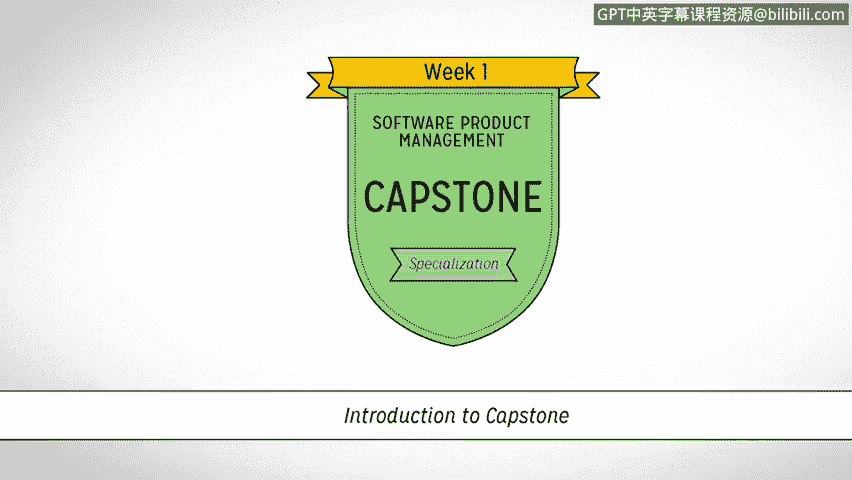

# 软件产品管理：6：《软件产品管理毕业项目》｜1_05_0-1-课程介绍

在本节课中，我们将要学习毕业项目的整体介绍，了解其结构、目标与时间安排。

你好，欢迎来到专项课程的最后一门课——毕业项目。

毕业项目将为你提供一个机会，应用你在先前课程中获得的技能。

这门课程将是你完成“诺克什”结构的最后一步，该结构代表了本专项课程的组织方式。毕业项目是“诺克什”的顶点。

毕业项目将引导你完成一个模拟项目。在该项目中，你将与一位客户、一位专家顾问以及一个由三名开发人员组成的小团队合作，为一家大型连锁书店创建一个软件项目。

这家连锁书店希望创建一个促进读写和阅读的应用程序，作为其“Lreach”计划的一部分。你将在初次与客户互动时了解更多细节。

这个毕业项目为期六周，模拟了六个工作周。

毕业项目的前三周是你的“冲刺零阶段”，项目的大部分规划工作将在此阶段进行。最后三周将包含三个为期一周的冲刺，你将在此过程中遇到现实的挑战。

在每一周，都会有各种互动环节、视频、阅读材料和/或作业。

所有作业都需要同伴互评，因此在安排学习计划时请务必考虑这一点。你需要分配时间来完成对同伴作业的评审。

我们建议你按照建议的时间线推进每周的学习。这将使班级能够在课程讨论中交流内容，同时不会泄露任何关键信息。

我们也努力使每周的工作量大致相当，以便你能有效地安排工作。

我们非常高兴你能参与这个毕业项目，更期待看到你如何将专项课程中获得的知识和专业技能付诸实践。

与往常一样，我们的课程工作人员将在论坛中解答你可能遇到的任何问题。

祝你好运，享受毕业项目的过程。

---

本节课中我们一起学习了毕业项目的总体介绍，明确了它是一个为期六周的模拟实践项目，旨在综合运用之前所学的软件产品管理技能。我们了解了项目的阶段划分、时间安排以及学习形式，为后续的深入学习做好了准备。