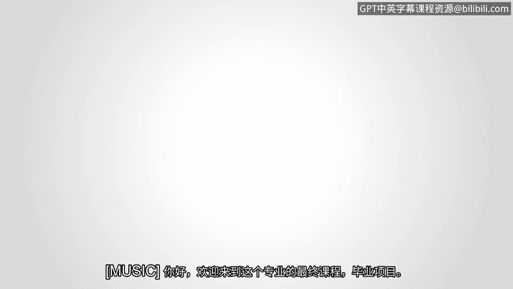
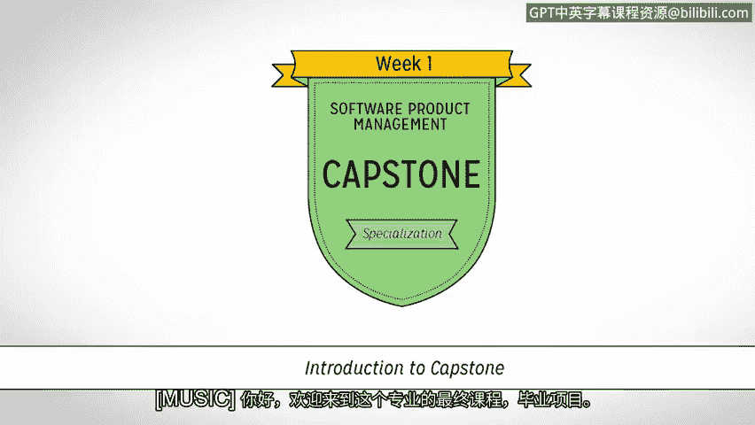

# 艾伯塔大学软件产品管理课程6：《软件产品管理毕业项目》｜software-product-management-capstone｜ - P2：1_第0.1节 简介.zh - GPT中英字幕课程资源 - BV1Su411T7fE

🎼。😊。

Hello and welcome to the final course and the specialization， the Capstone Project。

The capstone is going to give you an opportunity to apply the skills you've acquired from the previous courses。

This course will be your final step to completing thenoksh。

 which represents the structure of our specialization。The capstone Project is the head of theokesh。

TheCustoms project will take you through a simulated project in which you'll work with a client。

 an expert advisor， and a small team of three developers to create a software project for a large bookstore chain。

The bookstore chain is looking to create a literacy and reading application as part of Lreach initiative。

You will hear more about this when you initially interact with your client。

This capstone project is six weeks long and will asemate six working weeks。

The first three weeks of the capstone will be your sprint zero。

 in which most of the planning for the project will take place。The last three weeks wills three。

 one week sprints in which you will encounter realistic challenges。In each week。

 there will be various interactive portions， videos， readings， and or assignments。

The assignments are all peer reviewed， so please take that into account when you're scheduling your learning。

You will have to allot time for completing the reviews of your peers work。

We recommend that you progress through each week from the suggested timeline。

This will allow the class to talk about the content in the course discussions without revealing any key information。

We've also tried to make the workload each week of similar size so you can effectively schedule your work。

We are really excited to have you here in the Capstone Project。

 even more excited to see how you put your knowledge and expertise from the specialization to work。

As always， our course staff will be in the forums answering any questions you may encounter。

Best of luck and enjoy the capstone。