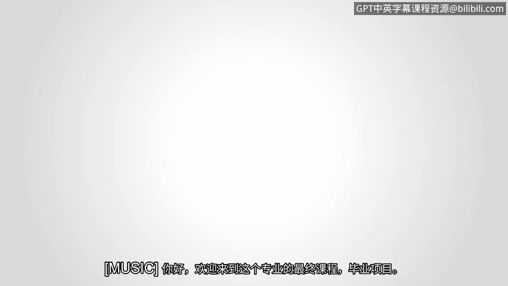
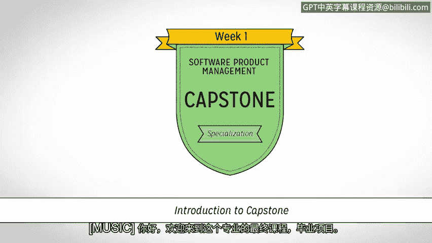

# 软件产品管理毕业项目：0.1：简介

在本节课中，我们将要学习毕业项目的整体结构、目标以及你将如何应用之前课程中学到的技能来完成它。

## 概述

欢迎来到专项课程的最后一门课程——毕业项目。这个项目将为你提供一个绝佳的机会，来应用你在之前课程中所学到的各项技能。这门课程是你完成整个专项课程学习路径的最后一步。

## 项目结构与目标

毕业项目是整个专项课程的顶点，它模拟了一个真实的软件项目环境。你将与一位客户、一位专家顾问以及一个由三名开发人员组成的小团队合作，为一家大型连锁书店开发一个软件项目。

这家连锁书店希望作为其“读写推广计划”的一部分，开发一款促进识字和阅读的应用程序。你将在初次与客户沟通时了解到更多详细信息。

## 项目时间安排

本项目为期六周，模拟了六周的工作时间。

*   **前三周** 是你的“冲刺零阶段”，项目的大部分规划工作将在此阶段完成。
*   **后三周** 将包含三个为期一周的冲刺阶段，你将在此过程中遇到各种真实的挑战。

## 课程形式与要求

在每一周的学习中，都会包含多种互动环节、视频、阅读材料和/或作业。

以下是关于作业的重要说明：
*   所有作业均采用同伴互评的方式。
*   在规划你的学习时间时，请务必为评阅同伴的作业留出时间。

我们建议你按照课程建议的时间线推进每周的学习。这样可以使全班同学在不泄露关键信息的前提下，在课程讨论区就学习内容进行交流。我们也尽力确保了每周的工作量大致相当，以便你有效地安排时间。

## 结语

我们非常高兴你能参与到这个毕业项目中，更期待看到你将如何运用在整个专项课程中获得的知识与专长。与往常一样，我们的课程团队将在论坛中解答你可能遇到的任何问题。

本节课中，我们一起学习了毕业项目的简介、结构、时间安排以及学习要求。祝你好运，并享受这个毕业项目的过程。