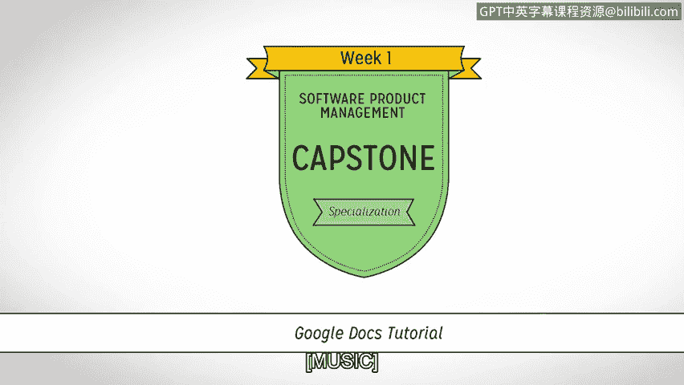
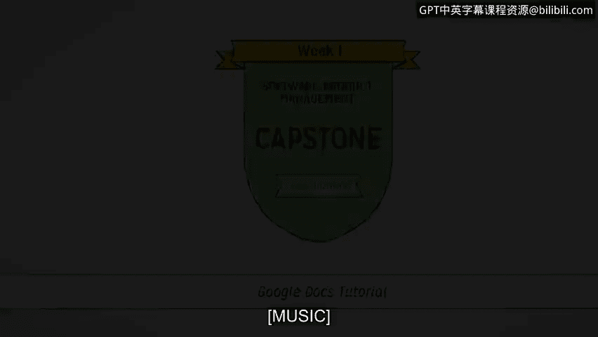
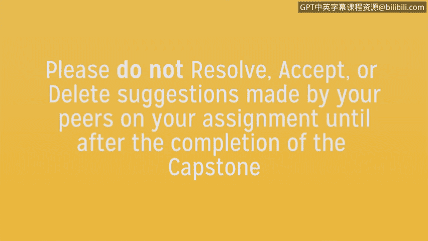

# 艾伯塔大学软件产品管理课程6：《软件产品管理毕业项目》｜software-product-management-capstone｜ - P30：5_08_1-8-tutorial-google-docs-tutorial-video-tutorial.en_subtitled - GPT中英字幕课程资源 - BV1Su411T7fE

🎼。😊。

We will be using Google Docs throughout the capstone for various tasks to access Google Docs。

 you are going to need a Google account。If you do not already have a Google account。

 please sign up for one now。We ask that you'll go through this entire tutorial。

 even if you have used Google Docs before。We will be covering some important steps that will be necessary for submitting your assignments。

Once you have created a Google account， go to the Google Docs homepage at Docs。google。com。

🎼You are then going to create a blank document by clicking the option for a blank document。

 Here is the resulting page that you should see。🎼The first thing that you should do is title your document。

The first document that you will create in Google Docs is your requirements document。

🎼So name it appropriately。🎼To rename your document。

 you can also click on where it says Untitled document。🎼Mmhm。🎼う。

🎼Now you can start creating your requirements document based on the information that you have elicited from the interactions with your client and the expert。

🎼This next step is very important。Your work is saved automatically in Google Docs。

But we are going to need to be able to share our work with our peers。

We do not want your peers to change your work， but we do want them to be able to make suggestions。

🎼For example， your peers will be conducting the requirements technical review on this document and they need to make comments。

🎼To share your work， go to the share button in the top right hand corner of your screen。

This dialogue will appear。🎼Click advanced。 This is the advanced sharing settings dialo that you will see。

 You want to click change。 You want to select on anyone with the link。🎼This is important。

 You will change the access from anyone can view to anyone can comment。

🎼Your linked sharing dialogue should look like this。

Double check that this dialogue says that anyone who has the link can access and anyone can comment。

If it does， click Save， this returns to the Sha settingstting dialog。

You are going to use this link to submit your assignment。Now。

 when your peer reviewer accesses your assignment via the assignment page on Coursera。

 they will be able to add suggestions and comments。Let's go through how to do that now。

This is what the document looks like when I access the link using a different Google account。

You'll notice the green Su mode。Now， when I type in the document， it appears as a suggestion。

You can also make comments by highlighting the text that you want to comment and then click the comment button found here。

🎼，🎼，🎼Please do not resolve， accept or delete suggestions made by your peers on your assignment until after the completion of the capstone。

You will be making comments to your peers requirementsquiments document in week  two during the Requi technicalical review assignment。

