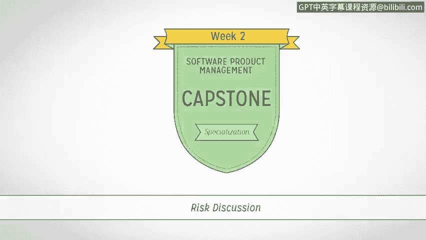
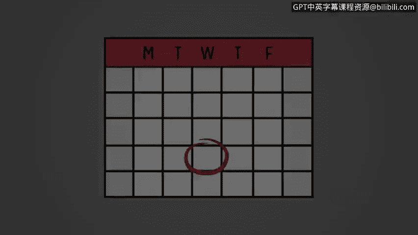

# 艾伯塔大学软件产品管理课程6：《软件产品管理毕业项目》｜software-product-management-capstone｜ - P31：6_01_2-3-video-simulation-risk-discussion-wednesday.en_subtitled - GPT中英字幕课程资源 - BV1Su411T7fE

🎼。😊。

🎼不是一不。😊，Okay everybody let's take some time to point out some risks that we may face with this project one thing that immediately came to mind for me were some of the features I think that some of the features that were suggested are going to actually be a little risky to implement things like the voice recognition and the remote connection with users are likely to cause us problems we just need to make sure。

That we really evaluate the value of these features before implementing them。

 I think they're things that we can do we just need to make sure that they're essential before we risk developing them Yeah I agree I've run into technology risks on other projects that I've for worked on in the past so we're thinking about developing this for Android and iOS potentially that could be risky I mean it's a lot of work and what if we run into compatibility issues with the different operating systems。

That's an excellent point， and it's definitely something to keep an eye on。

I've worked with Lisa before in the past and she's been known to change her mind a lot it's just something to keep in mind。

 but don't get me wrong like her ideas are amazing and when she has them it's always for the best it's just。

Something that happens often with her。What if someone gets sick we're a small team and everyone is important that's a good point no one is allowed to get sick what about the database。

 they've updated it since I worked with it last so we don't know what it's going to be like。I mean。

 hopefully it's something that we can work with easily。

But it was really glitchy the last time so unless that's been fixed。

 I would say this project is a bust and I would say that's a very high risk。 Yeah。

 that's a good point that makes me nervous。 I'm sure it will be fine。

 It was designed with projects like this in mind， so I'm sure it will be easy to use。

We'll just have to wait and see。 I'm sure it'll be easy to use。

So does anyone else have any other risks， not that I can think of nope。Great。

 then let's make a risk plan。