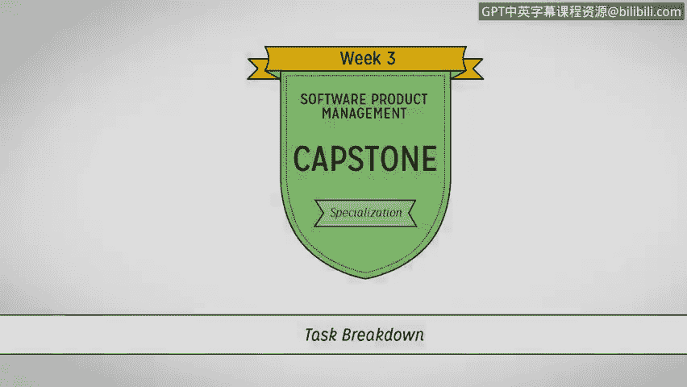

# 艾伯塔大学软件产品管理课程6：《软件产品管理毕业项目》｜software-product-management-capstone｜ - P32：7_07_3-10-video-simulation-task-breakdown-meeting.en_subtitled - GPT中英字幕课程资源 - BV1Su411T7fE

🎼。😊。

Okay， so let's get started on these user stories， let's start with the one about the tablet that one should be easy。

The only thing for that one is we need to design the wire frame for the application and we need to set up the iOS development environment。

 Okay， Yep， I've made post notes for both those。 Great， so let's break down that user story。

The database of material is already made。 We don't have to create anything。 No。

 we just need to set up the connection to the database， and then we should be good to go。 Alexa。

 you want to write that down。 Yep， way ahead。 We're also going to need a task to write the source code for pulling material from the database。

 I made that one， too。So what's our review process going to be like？

Are we going to be reviewing code？If we're a pair of programming。We don't really need to review code。

Are we really going to do pair programming that just slows me down Well。

 I think its would be really good for the team and I think everyone could learn something from your experience。

How about we designate certain times for pair programming then if someone is struggling or just needs an extra set of eyes for their code they can ask for a partner to pair with Yeah it sounds reasonable Yeah I guess so。

Okay， well then if that's the case， we need tasks for reviewing code unless it's pair programming。

 of course。Got it。 great， so sticking with good coding standard。

 I think we should do test driven development， So we'll need tasks for writing and executing unit tests。

 Are we really going to do unit tests。We should always do unit tests。

 I think it's a good practice to use I think we should also do acceptance tests。Great idea。

 write down those tasks so we'll need to write acceptance criteria and tests and we'll need a task for executing them。

 Okay， I'll make this。 See like a pretty complete list。 What about documentation。

 We're going to need some internal documentation that says how for the database connection The agile manifesto says we don't need documentation。

😊，No， the Agile manifesto says that they value working software over documentation。

 not that they don't need documentation。The database is a pretty complex piece of software。

 we're definitely going to need some documentation that says how it works。

We're all going know how it workssh seriously I mean not seen this on other projects What if we're not here for all eternity someone's going to need to use the database or maybe another project will want to use the database there's no point in reinventing the wheel All right。

 let's everyone take a deep breath。Alexa， you're right， we will need some internal documentation。

For the database。Are we going to need a user manual for this feature， I don't think so。

 the connection happens automatically for the users， so there's no real need for a user manual。Okay。

 I think this looks pretty complete。 Let's move on to another user story。

IfThat one seems pretty straightforward， we just have to write the source code， review the code。

And then add those tests we decided on so write code， review code。

 write and execute the unit tests and acceptance tests Oh and create the acceptance criteria I think this feature will need internal documentation and a user manual Alexa could you write those down please we're going to have to design that feature too Oh yes。

 of course， could you write that down to please。So I think we've established a good process here。

 we'll send you the rest of the tasks as we create the user stories。

