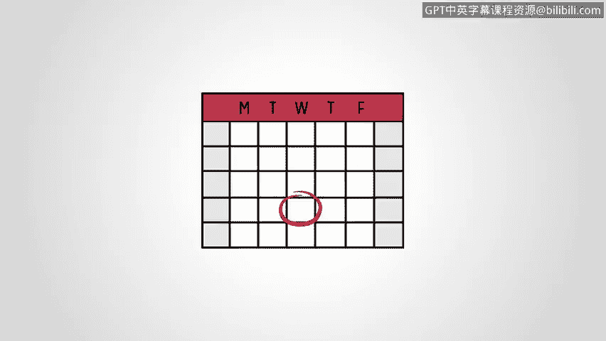

# 软件产品管理：6：《软件产品管理毕业项目》｜P33：8_01_4-1-视频模拟：周三站会

## 概述

在本节课程中，我们将通过一个模拟的站会场景，观察一个软件开发团队在项目第一周中期如何同步进度、讨论问题并规划当日工作。你将了解到站会的基本流程、团队成员如何报告工作，以及如何协作解决障碍。

---

我们已进入开发第一周的中段，团队取得了一些良好进展。

现在开始今天的站会，谁想先来分享？

我可以开始。昨天我着手处理了“读者连接”功能。

该功能已基本完成。我今天应该就能最终完成它，之后我将添加音频部分。

目前没有任何事情阻碍我。

好的。

昨天我在处理页面格式化工作。这被证明有点困难。

一些功能的表现不如预期，元素的排列方式未能达到我的要求。

我已将其设置为能在竖屏和横屏模式下工作，但图片的插入打乱了布局。

所以我今天会继续处理这个问题。

至于阻碍，是的，这项工作比我预想的要花更长时间。

昨天我设置了iOS开发工具，现在它们已准备就绪。

今天我打算为进行中的功能编写验收测试和验收标准。

这样，当相关功能编码完成后，你们就可以运行这些测试。

我们本应更早开始这项工作，但没关系，我相信我们能完成。

我目前没有遇到任何阻碍。

如果有人需要帮助处理页面布局，我可以与某人交换任务，进行结对编程。

也许我们只需要一个新的视角。我感觉我离解决它很近了。

但如果今天下午我仍在挣扎，或许我们可以调整一下。

我不介意帮忙处理验收相关的工作。

好的，无论如何请告诉我。

我认为我们可以结束站会了，大家开始工作吧。

---

## 总结

本节课我们一起观察了一次典型的敏捷站会。站会中，每位成员依次说明了**昨日完成的工作**、**今日计划**以及**遇到的阻碍**。团队通过简短的沟通同步了进度，主动提出了协作建议（如结对编程），并明确了下一步行动。这种日常同步机制有助于保持团队信息透明，及时发现问题并促进协作。