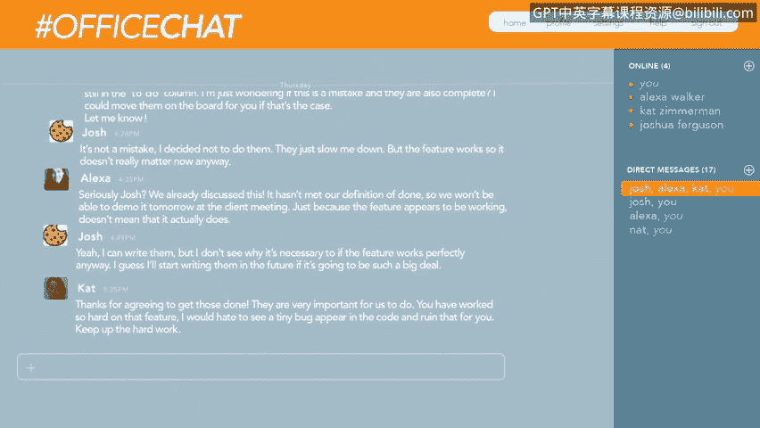

# 艾伯塔大学软件产品管理课程6：《软件产品管理毕业项目》｜software-product-management-capstone｜ - P34：9_03_4-4-simulation-office-chat-conversation-thursday.en_subtitled - GPT中英字幕课程资源 - BV1Su411T7fE

🎼呼呼呼。🎼咕嘟咕嘟。🎼不呼你不停。😊，🎼不不噗。🎼不会自。🎼。🎼不不。🎼呼呼呼。🎼うつ？🎼。

