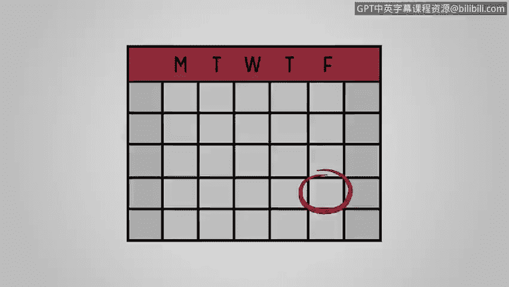

# 艾伯塔大学软件产品管理课程6：《软件产品管理毕业项目》｜software-product-management-capstone｜ - P35：10_04_4-5-video-simulation-standup-meeting-friday.en_subtitled - GPT中英字幕课程资源 - BV1Su411T7fE

🎼。😊。

🎼不是一不。😊，Okay， so today is the day we only have this morning to finish things up before the demo Okay so I finished all the page layout features yesterday so the page looks like a book page the background is in off white works in portrait and landscape and you can see all the pictures and the font size is adjustable so the user should be able to read without a partner and I did all the unit tests and by the end of the day they passed the only thing I haven't done yet is right the documentation so I'll get that done today and no blockers for me。

Great all the acceptance tests for those features are complete。

 I verified the acceptance tests earlier this morning so those should all run smoothly for you Yeah when did you do that？

😊，Like， how long have you been here？ Well， I went to an excellent sunrise yoga class this morning at 5。

 and I was in the office by7。Yeah， that sounds awful。It was rejuvenating。 You should try it sometime。

 It might help you concentrate and find your inner calm。 Okay， now we're getting offomic。Right。

 so yesterday I finished all those acceptance tests。

 I pair programmed with Alexa for a bit and like I said， verified the acceptance tests。

 So things are looking wonderful。 so yesterday I finished up the audio connection。

 Go that up and working。 Ka， did you play with that this morning， It's pretty cool Hey， Yeah。

 all right， and so anyways， then I guess I'll start working on those unit tests。😊。

Pretty pointless now that the audio is up。You still need em。

 You said youre gonna get that done last night。 Yeah， yeah， all right。 anyways。

 I wrote a little bit of the documentation yesterday。

 but I don't think I'm gonna to have time to get that done before the demo。

 so can I get some help with that。 Y， I could help you with that？

 I might need to clarify some things So do you mind if I come work next to you so I can ask you questions as I need。

 Yeah， that works for me， sure。😊，Does anyone need to get anything else done before the demo？Awesome。

😊，Let's get to work。