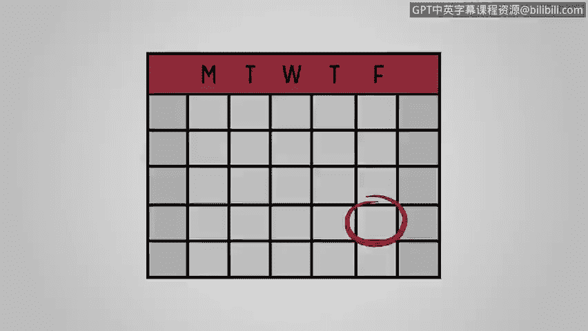

# 软件产品管理毕业项目：P35：模拟站立会议（周五）

## 概述
在本节课程中，我们将通过一个模拟的周五站立会议场景，了解在软件产品演示（Demo）前一天，团队成员如何同步进度、识别风险并协调最后的工作。会议聚焦于功能完成度、测试状态以及文档撰写等收尾任务。

## 会议内容记录

上一节我们介绍了迭代开发中的日常同步，本节中我们来看看项目演示前的最后一次站立会议是如何进行的。

以下是会议中各位成员的进度汇报与讨论。

**成员A：**
我昨天完成了所有页面布局功能。页面现在看起来像书籍页面，背景为米白色，支持横屏与竖屏显示。用户可以查看所有图片，并且字体大小可调，确保用户能够独立阅读。我完成了所有单元测试，并且在昨天结束时它们都通过了。我唯一还没做的是编写文档，我计划今天完成。目前没有遇到任何阻碍。

**成员B：**
很好。所有这些功能的验收测试都已完成。我今天早上早些时候验证了验收测试，所以对你来说运行应该会很顺利。

**成员A：**
你什么时候做的？你到办公室多久了？

**成员B：**
我今天早上5点参加了一个很棒的日出瑜伽课，7点就到办公室了。

**成员A：**
听起来挺可怕的。

**成员B：**
那让人精神焕发。你有时应该试试，它可能帮助你集中注意力，找到内心的平静。

**成员A：**
好了，我们跑题了。

**成员B：**
对。所以我昨天完成了所有那些验收测试。我和Alexa结对编程了一会儿，并且如我所说，验证了验收测试。所以一切看起来都很棒。

**成员C：**
我昨天完成了音频连接功能，已经启动并运行了。Ka，你今天早上试过了吗？挺酷的。

**成员B：**
嘿，试过了，没问题。

**成员C：**
总之，我猜我会开始着手那些单元测试了。

**成员A：**
现在音频功能都做好了，做单元测试有点没必要了吧。但你仍然需要它们。你昨晚就说要完成的。

**成员C：**
是，是，好吧。总之，我昨天写了一点文档，但我觉得在演示前我没时间完成它了。我能得到一些帮助吗？

**成员B：**
我可以帮你。我可能需要澄清一些事情。你介意我坐在你旁边工作吗？这样我可以在需要时问你问题。

**成员C：**
没问题，可以。

**会议主持人：**
在演示之前，还有人需要完成其他事情吗？

**全体：**
没有。

**会议主持人：**
很好。我们开始工作吧。

## 核心要点总结
本节课中，我们一起学习了项目演示前站立会议的关键要素。会议展示了团队成员如何清晰汇报进度（如“完成了页面布局与单元测试”），确认验收标准（“验收测试已验证”），并提出协作请求以解决剩余任务（如文档撰写）。有效的沟通与及时的帮助请求是确保项目顺利收尾的重要实践。