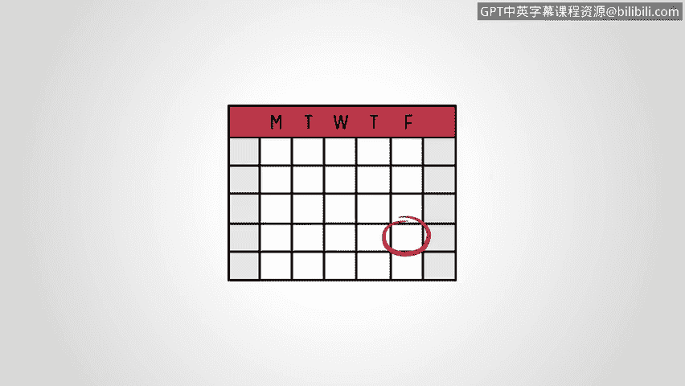
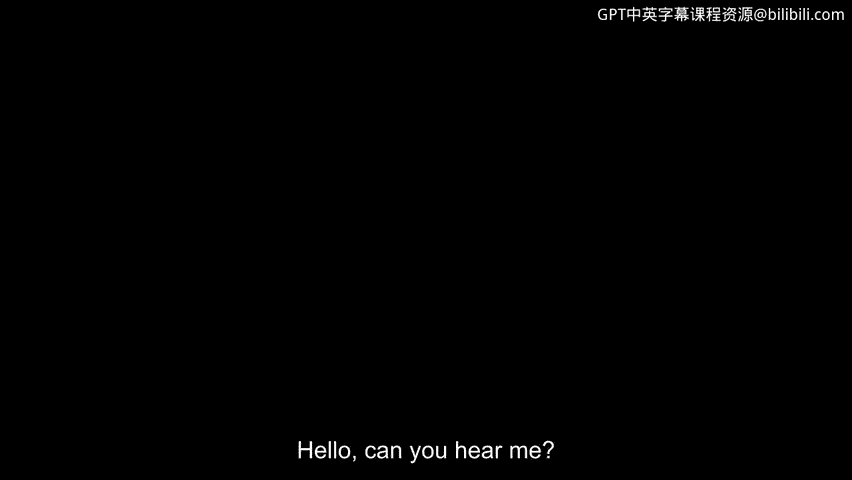

# 艾伯塔大学软件产品管理课程6：《软件产品管理毕业项目》｜software-product-management-capstone｜ - P36：11_05_4-6-video-simulation-client-demo-and-backlog-refinements-friday - GPT中英字幕课程资源 - BV1Su411T7fE

🎼。😊。

🎼不不是你不。😊，🎼呼呼。😊。

🎼，Thank you so much for doing this。 I'm really looking forward to seeing how everything's coming along。

 Okay， well， let's get started。 so what we've built is a tablet app that supports audio connection between users。

 We have two devices here today to demonstrate the connection feature。😊。

So as you can see right now our app displays a book that is laid out to look like the user is reading an actual book。

 any pictures that are associated with the material are displayed on the page。

 you can also adjust the font size so that the user can easily read the text and the tablet can be used in portrait or landscape mode。

All right， so we're going to show you now our audio connection so we decided to go with a peer to peer audio connection because it allows the children to still talk to each other。

 but it uses less data and it protects the identities of the children better I believe there was video going to be implemented at some point but。

Anyways， so the user can press this button here to connect to other users online。

And since these are the only two devices online with the app right now， they're going to connect。

And then you can start on audio stream by pressing here。

And now the two devices should be able to talk to each other。

 so I'm going to go outside and I'm just going to give you guys the full effect。Hello。

 can you hear me Hi Josh， we can hear you loud and clear。

Great， pretty cool， hey， I'm going to come back now。So that's our functionality as of right now。

 we've gotten our high priority high risk features developed， so it should be easier from here on in。

 Did either of you have any questions。Wow guys， great work。Did you end up using the white background。

 like I suggested， the off white background。 Yes， we did。 You were totally right。

 I actually tried using a bright white background。 Does is see what difference it would make。

 And it made a huge difference， just changing the hue even just a little bit。

 I played around with various shades of white， but I think that this one still gives a lot of contrast。

 but doesn't strain the eyes。 What do you guys think。 Yeah， I agree。

 I think this shade looks just fine。I really like the audio connectivity。

It's really exciting to see this all come together。

 I'm really excited to see how it's going to impact literacy。 I'm hopeful。 great work， guys。😊，Lisa。

 did you have any feedback？Well， I am just floord with what youve created so far。

 I think it looks excellent。 The page layout looks so good。

 I think it's incredible that you can even increase the font size without losing too much of the fidelity of the page。

 Excellent work。😊，So。What features are you planning to develop next Well for the next sprint。

 we're hoping to get the account set up and also create the browsing selecting and search features so users will be able to find books okay so that sounds good I've been thinking about this project for a long time and I have a few other ideas for some features I think it would be really cool if the reader could highlight text on the page and then their highlights could be saved once the exit the book。

I also think we should have a book marking feature so that the reader can save the progress in a book。

And I think we should feature audiobook so that the reader can listen while a recording reads to them。

 They can even follow along in the book。 I took a peek through the database of materials and I didn't see any audio recordings in there。

 Did I just miss that or did that get saved somewhere else。 Oh you're right。

 We don't have audio books included in that material yet and we're still in negotiation。

 So let's just forget that idea for now。 that could be something for the future for when we have audiobooks included in the database。

 Okay， well， thank you so much for your suggestions， Lisa。

 we will definitely take those into account。 they sound like fantastic features。

 So let's now move to the backlog refinement。 Daniel。

 did you have any more questions before we get to that with Lisa No everything looks great。

 Keep up the great work guys I'll see you next week。哎。Okay。

 let's start by adding the new features to the backlog。 Okay， I can do that。

 What should we call them。As a reader， I want to highlight text from a book so that I can remember an important aspect of the book。

You also need to save the highlights when the user exits the book。Right， I think you can。 Okay。

 so let's make that two different stories。 And the second story could be the as a reader。

 I want the things that I highlighted to be available after I exit so that。I can look at them。

I definitely think you're on the right track， but how about we say as a reader。

 I want the highlights I created to be saved after I exit the book so that I can review them when I return to the book。

How does that sound， That's much better。Okay， so those two are created， what was the other one again？

Bookmarks， Oh yeah。Okay， how about as a reader， I want to bookmark my place in the book so that I know where I left off？

I think we can word it a bit better than that。 What do you think about as a reader。

 I want my place in the book to be saved so that I can return to that place at a later time。 Yes。

 okay。 Yeah， I'll write that down。Great， so next we should assign priorities， story points。

 and risks to all of these。I think these are all pretty low risk。

 do we agree I think bookmarks should be one but saving highlights should be moderate things can get complicated when you start saving Okay。

 I can see that and what do we think for story pointss？Oh。

 let's do that simultaneous reveal thing that we did before。

 where we all hold up what we think the story point should be at the same time。 That way。

 there won't be any bias。 Great idea。 on the count three。

 Hol up the number of story points you think the highlighting feature will be。One，2， three。

A unanimous decision， one story point it is， so let's move on to saving highlights， okay， one， two。

 three。Very good。 I think we're getting good at this。

 So two story points for that one and now for the bookmarking feature。😊，Get ready，1，2，3。Darn。

 man out that's okay， I was debating between two and three story points anyway。

 so I would be fine with giving that one through story pointss。Okay， fantastic。

 Let's start prioritizing for the next sprint。 Okay。

 so we need to connect the application to the database。😊，We need to save the material locally。

 set up browse features with covers of the books， select reading material and search material。

Create the accounts， create login and resetting password features。

 and sort reading material based on comprehension difficulty of genre。

So I think we have our work cut out for us from a development standpoint。

 getting that database connection set up is got to be our highest priority is going to be a pretty awful app if that doesn't work。

I think things like sorting features and saving material locally can be our lowest priority because even if we get everything else created。

 we're going to have a pretty functional product Well I agree with you for the most part I would say that the database connection is definitely the highest priority and sorting is probably the lowest priority here in fact I would say implementing the bookmarking feature is more important than that。

Oh I know what I come to think about it。Accounts is pretty low priority。

I would order these as bookmarking sorting than the accounts I would rather have the save locally than the accounts being able to access the books without a wireless connection is very important to me Okay。

 I can see that so if you had to prioritize these for the next sprint you would say database is most important browsing selecting and search features medium priority。

And then you would prioritize saving locally above bookmarking sorting and accounts。 Yes。

 if that sounds good。 Okay， we have to remove some features from the sprint just because I think we're over our story points。

 but we'll work that out when we redo the release plan。 Thank you so much for your input。

 It was very helpful， Lisa Thank you all so much。 Keep up the excellent work。

 I can't wait to see what you accomplished next week。ll see you the next demo by Lisae。

