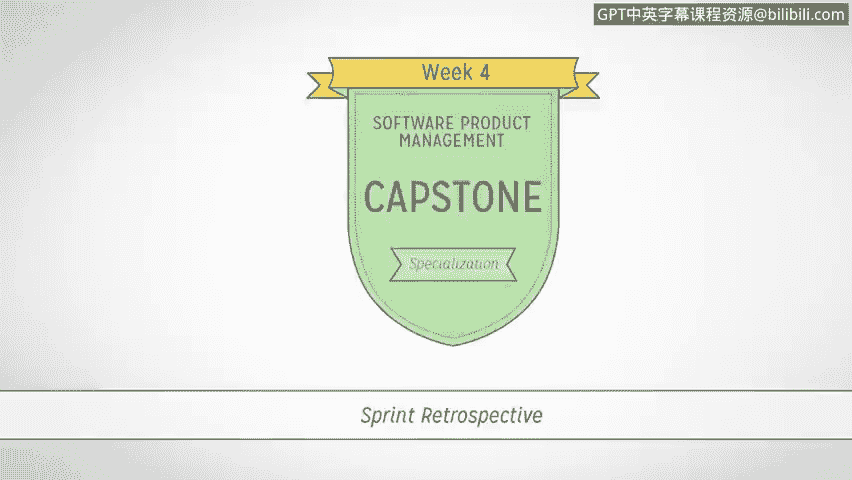

# 软件产品管理：6.12：模拟冲刺回顾会议

在本节课中，我们将通过一个模拟的团队对话，学习如何有效地进行一次冲刺回顾会议。冲刺回顾是敏捷开发中用于反思和改进团队工作方式的关键活动。

## 概述

冲刺回顾会议旨在让团队反思刚刚结束的冲刺周期，总结做得好的地方和需要改进的地方，并制定具体的行动计划，以便在下一个冲刺中做得更好。这是一个协作、非指责性的过程。

## 会议开场

上一节我们介绍了冲刺回顾会议的目的，本节中我们来看看会议是如何开始的。团队领导需要引导会议，并确保每个人都感到舒适和安全。

团队领导提议进行一次快速的回顾会议，认为团队可以从中学习，并对未来的工作有益。在获得团队成员同意后，领导建议了会议的基本流程：首先头脑风暴讨论做得好的和不好的地方，然后基于讨论结果找出改进方法。

## 总结成功经验

以下是团队认为在本次冲刺中做得好的方面：

*   **完成了所有预期的用户故事**：这是一个显著的成就，尤其是在第一个冲刺中。
*   **坚持了每日站会**：虽然不是每天早上的第一件事，但团队总能找到时间完成。
*     **用户故事均符合“完成的定义”**：所有工作成果都达到了团队预先设定的质量标准。
*   **交付了可工作的产品**：团队最终交付了一个令人印象深刻的可运行产品。

## 识别改进领域

在肯定成绩之后，团队需要以建设性的态度审视可以做得更好的地方。这个过程不是为了指责，而是为了持续改进。

以下是团队识别出的待改进事项：

*   **单元测试编写滞后**：有成员承认在开始编写功能源代码之前，没有先写好单元测试。
*   **验收测试和标准定义较晚**：团队应该在开始开发之前就写好验收测试和标准。
*   **任务板使用不足**：任务板在冲刺期间多次未能准确反映实际进度，需要更勤勉地更新任务状态。
*   **故事点估算的准确性有待验证**：虽然所有任务都按时完成，但个体故事点的估算精度可能需要更多冲刺周期来验证。

## 制定改进措施

基于识别出的问题，团队接下来需要商讨具体的、可执行的改进方案，以便在下一个冲刺中实施。

以下是团队为下一个冲刺制定的改进措施列表：

1.  **提前编写验收测试和单元测试**：确保测试活动先行。
2.  **更积极地使用任务板**：及时更新任务状态，保持信息透明。
3.  **增加结对编程**：通过结对编程来加强知识共享、代码质量和团队沟通。
4.  **持续关注并改善团队沟通**：将沟通改善作为一个持续的目标。

## 会议总结与结束

在制定了明确的改进计划后，团队领导对会议进行了总结。大家一致认为这次回顾非常有帮助，并对下一个冲刺的工作感到兴奋。会议在积极的氛围中结束。

## 总结

本节课中我们一起学习了冲刺回顾会议的完整流程。从会议开场、总结优点、识别不足，到最终制定具体的改进措施，每一步都旨在促进团队的反思与成长。记住，有效的回顾会议核心在于**心理安全**、**聚焦改进**和**行动导向**，其目标是让每个后续的冲刺都比前一个更加高效和顺畅。