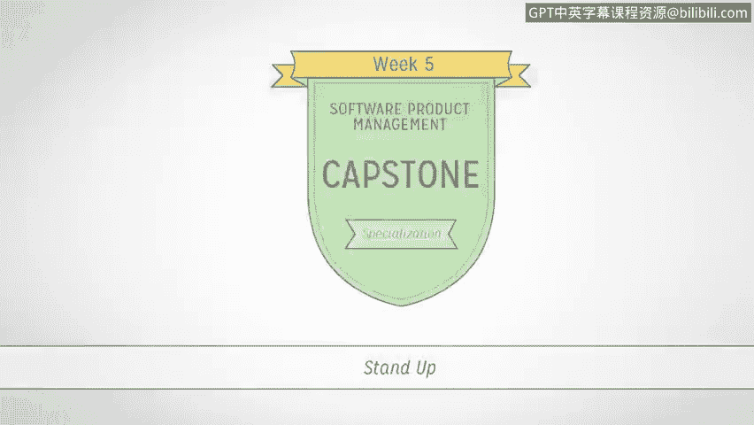

# 艾伯塔大学软件产品管理课程6：《软件产品管理毕业项目》｜software-product-management-capstone｜ - P38：13_01_5-1-video-simulation-standup-meeting-monday.en_subtitled - GPT中英字幕课程资源 - BV1Su411T7fE

🎼。😊。

🎼不是一不。😊，🎼Okay so I'm going to start today， I'm going to start working on the database connection because most of the other user stories that we have to complete this sprint depend on that connection in some way or another。

 so we need to get that done optimisticistally I should be able to get that done by the end of today if not tomorrow。

But seeing as it is the first day， I have no blockers Okay， Wilson since you'll be working on that。

 then we can get some design elements complete and create the acceptance， tests and criteria。

Great idea Alexa Okay， well I guess I'll go next I'm gonna to start designing the interface for the browsing in bookmarks and then I'll also create the acceptance criteria and tests for the browse book covers and bookmarks features The only blocker I have right now is that it would be nice to have the connection but I can start programming using the hard coded material like we did in the last sprint so I should be fine for a couple days I'm going need the database connection to complete my task I mean I could use CA data。

 but I think it would be easier just to wait for the database so I can just create the acceptance tests and start writing my unit tests。

😊，I could also do the acceptance test for you Josh。

 and that way you can focus all your energy on that connection That sounds good to me he。

Let's get to a team。