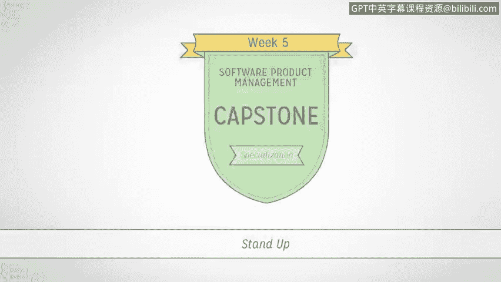

# 软件产品管理毕业项目：6：模拟站立会议（周一）

在本节课中，我们将通过一个模拟的周一站立会议场景，学习敏捷开发团队如何规划冲刺（Sprint）初期的工作。我们将看到团队成员如何同步进度、识别依赖关系并协作解决问题。

---

上一节我们介绍了冲刺规划会议，本节中我们来看看团队如何在冲刺开始后的每日站立会议上同步工作。

以下是模拟会议中每位成员的发言与计划。

**项目经理（PM）**：
我将从今天开始着手处理数据库连接。因为我们这个冲刺中需要完成的大部分用户故事，都在某种程度上依赖于这个数据库连接。
乐观估计，我应该在今天结束前完成它，最晚不超过明天。
鉴于今天是冲刺的第一天，我目前没有遇到任何阻碍。

**设计师（Wilson）**：
既然你将负责数据库连接，那么我们可以同步完成一些设计元素，并创建验收测试和标准。

**前端开发（Alexa）**：
好的，接下来我来说。我将开始设计浏览和书签功能的界面。同时，我也会为“浏览书籍封面”和“书签”功能创建验收标准和测试。
我目前唯一的阻碍是，最好能有数据库连接。不过我可以像上个冲刺那样，先使用硬编码的材料开始编程，所以几天内应该没问题。

**后端开发（Josh）**：
我需要数据库连接才能完成我的任务。我的意思是，我也可以用模拟数据，但我觉得等数据库弄好会更方便。所以，我可以先创建验收测试，并开始编写单元测试。

**测试工程师**：
我也可以帮你做验收测试，Josh。这样你可以把所有精力都放在数据库连接上。

**Josh**：
这听起来不错。

**团队**：
让我们开始工作吧。

---

本节课中我们一起学习了敏捷团队在周一站立会议上的典型沟通模式。我们看到团队成员如何明确各自任务、识别对共享资源（如数据库）的依赖，并通过主动协作（如分担测试工作）来确保冲刺目标顺利推进。这种简短的每日同步是保持团队信息透明和快速响应障碍的关键。