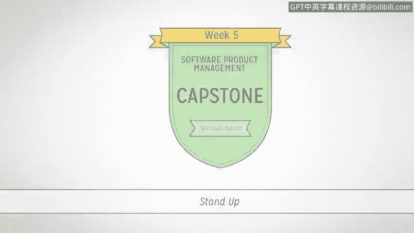

# 艾伯塔大学软件产品管理课程6：《软件产品管理毕业项目》｜software-product-management-capstone｜ - P39：14_02_5-3-video-simulation-standup-meeting-wednesday.en_subtitled - GPT中英字幕课程资源 - BV1Su411T7fE

🎼。😊。

🎼不是一不。😊，🎼ふふふ。

All right everyone let's see where we're at so far。

 I realize we're a bit behind schedule because we just got the connection set up。

 but thankfully that is all done so we're good to go so things should hopefully run smoothly from here on in Yeah sorry guys that took way longer than expected yesterday but I got the database connection finished and I wrote those unit tests in there as well and they all passed when I executed so hopefully the connection should work well for everyone。

Today I'm going to be working on the search feature and as of right now I have no blockers Okay well yesterday I was working on the source code for the browse and select features。

 the book covers and bookmarks and so I'll just continue working on that today and then if I get the layout program today then I'm going start connecting the database to it So no blockers for me right now but Josh I may need your help later if when to get to the connection Yeah I can do that just let me know Yeah it's fine well I'm going to start writing source code for the saving locally feature today yesterday I was working on documentation for a couple of the features while I was waiting for Josh to finish up the connection but now that's complete I can really start to work on this feature and now that the connection is finished I don't have any blockers so let's get to work we've got a lot of catchchup to do。

