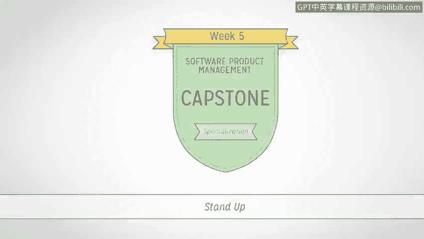

# 软件产品管理毕业项目：P40：15_03_5-4-视频模拟：周五站会

在本节课中，我们将通过一个模拟的周五站会场景，了解敏捷开发中每日站会的实际流程与沟通要点。我们将看到团队成员如何同步进度、识别风险并协调工作。

## 会议开始

让我们看看目前的进展。我不确定我们是否能在今天下午演示前100%完成所有工作。

## 成员进度汇报

以下是团队成员依次汇报的工作状态：

**成员A（负责搜索功能）：**
昨天，我正在编写搜索功能的源代码。我已经实现了一个搜索函数 `searchDatabase(query)`，它可以查询数据库。但我仍需将其连接到前端应用程序。这是我今天上午要完成的主要工作。

**成员B（负责本地保存功能）：**
我即将完成本地保存功能。昨天结束时我运行了单元测试，发现了一些错误，但我认为修复起来不会太难。这是我今天上午要处理的工作。该功能的其他部分均已完成。一旦这些测试通过，我的任务就完成了。目前没有阻碍。

**成员C（负责浏览与书签功能）：**
我完成了浏览功能，书签也能显示出来，但视觉效果不佳，尺寸比例有问题。我所有的单元测试都已通过。今天上午我会花些时间，尝试让书籍封面的显示效果更好一些。我应该在会议前完成所有文档的编写。我这边也没有阻碍。

## 会议结束

那么，我们开始工作吧。

---

本节课中，我们一起学习了敏捷站会的模拟场景。我们看到了三位团队成员如何清晰地汇报昨日成果、今日计划以及遇到的障碍。有效的站会沟通有助于团队保持同步、快速发现问题并集中精力完成冲刺目标。