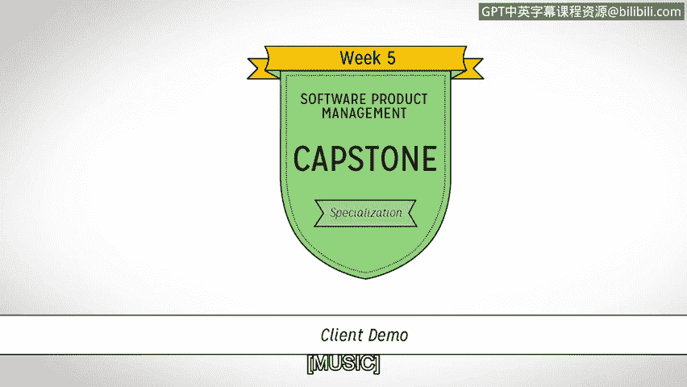

# 软件产品管理：6：毕业项目 - P41：16_04_5-5 客户演示模拟

## 概述
在本节课中，我们将通过一个模拟的客户演示场景，学习如何向客户展示产品功能、收集反馈，并规划下一个开发冲刺。我们将看到开发团队如何演示一个电子书阅读应用的核心功能，以及客户如何提供关键反馈来指导产品的未来方向。

---

## 演示开场与核心功能展示

感谢各位今天到场。我们的产品进展非常顺利，许多核心功能已经完成，因此这将是一次令人兴奋的演示。我将请Alexa开始介绍。

是的，我负责的是浏览功能。现在用户可以从数据库中浏览所有资料，可以滚动查看所有书籍并看到每本书的封面。当用户决定要读哪本书时，可以选择它。

如果用户之前从未读过这本书，选择后会直接进入书籍开头。如果用户之前已经开始阅读，应用现在会自动保存阅读进度，并将用户带回上次离开的地方。这意味着应用现在具备了**自动书签功能**。

此外，用户还可以搜索书籍。他们只需输入任何内容，浏览页面的结果就会根据搜索内容进行筛选。用户可以按**流派、书名、作者**或任何相关关键词进行搜索。

同时，你可能已经注意到，我们的应用已经连接到数据库。这意味着你们提供的所有资料，在无线网络连接下，都可以通过应用供用户使用。

---

## 离线阅读功能演示

我们的最后一个功能是本地保存资料的能力。当用户在浏览资料时，每本书旁边都有一个小的保存按钮。如果用户按下它，这本书就会保存到他们的设备上。这样，即使没有无线连接，用户也能查看和阅读这本书。

让我们来测试一下。我们选择这一本。现在，我们将设备切换到飞行模式，断开无线连接。然后我们返回应用。如你所见，除了我选择的那两本，所有其他书籍都已从浏览功能中消失。然后你可以像平常一样打开并阅读它们。

以上就是我们的演示。你们有任何问题吗？

---

## 客户反馈与未来规划

你们再次让我感到震惊。我简直不敢相信，仅仅两周时间，你们就完成了所有这些工作。

现在，我有一条关于这个项目未来的消息。但在谈这个之前，Daniel，你有什么想说的吗？

你们确实做得非常出色。我认为一个可能非常有价值的功能是，在浏览页面和实际阅读页面之间增加一个页面。我想读者会希望看到一个包含**简介或评论**等的页面，这样他们才能真正决定是否要读那本书。

另一件需要记住的事情是孩子，要关注孩子。所有这些功能都对儿童友好，但在上一次演示中，你们更多地关注了儿童。如果你们需要帮助，让这些功能对儿童更友好，请随时联系我。

是的，我们不想忽视儿童用户，这将非常重要，尤其是在下一个冲刺阶段。这引出了我要宣布的消息。

我过去可能跟你们提过一个教育贸易展。我们曾试图获得一个展位，但没有成功。现在，有一个展位空出来了，他们提供给了我们。问题是，展会就在下下周，所以我们需要一个相当扎实的原型在下一个冲刺阶段进行演示。鉴于你们刚刚展示的工作成果，我认为这不是问题。但我们应该讨论一下你们下一个冲刺要开发的功能。

考虑到贸易展的性质，我认为我们应该专注于产品的教育功能方面。

Daniel，你有空留下来帮我们决定下一个冲刺要开发哪些功能吗？

当然可以。

太好了，太棒了。那么，你们大家觉得怎么样？

我认为这听起来绝对太棒了。这是一个展示我们所有辛勤工作的绝佳机会。

听起来很酷。

我同意。

好的，我认为最合理的做法是回去讨论下一个冲刺的功能。你们觉得怎么样？

听起来很棒，带路吧。

---

## 总结
本节课中，我们一起学习了一个完整的客户演示与反馈收集流程。我们看到了开发团队如何清晰地展示**浏览、搜索、自动书签和离线阅读**等核心功能。更重要的是，我们学习了客户反馈如何提供关键的产品改进方向，例如增加书籍详情页和深化儿童友好设计。最后，我们看到了外部机会（如贸易展）如何影响产品路线图，并促使团队围绕新的目标（教育功能）规划下一个开发冲刺。这个过程体现了软件产品管理中持续沟通、灵活调整和以用户为中心的核心原则。