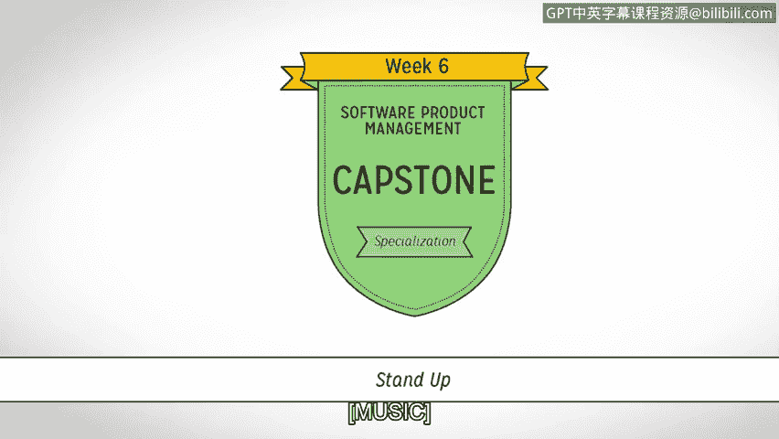
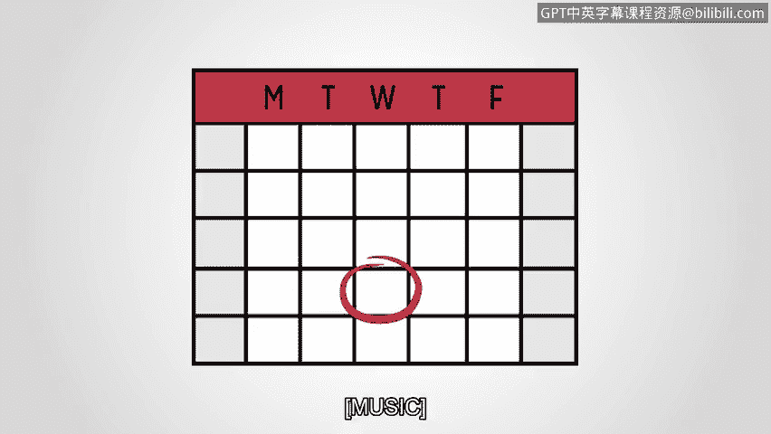

# 艾伯塔大学软件产品管理课程6：《软件产品管理毕业项目》｜software-product-management-capstone｜ - P44：19_01_6-1-video-simulation-standup-meeting-wednesday.en_subtitled - GPT中英字幕课程资源 - BV1Su411T7fE

🎼。😊。

Okay let's make this quick I've got a lot of work to do yesterdayday I took that reading comprehension quiz that Daniel gave us and I turned it into a feature all the tests passed on that one I even had time to finish up the docs I just need someone to conduct the acceptance tests on it and we should be good to go Alexa already reviewed the code。

Today I'm going to be working on matchmaking the remote users based on their reading level Ka。

 I would like it if you could have those accounts set up before I start working on having the reading improvements tracked I can do it without but it would save a lot of time When do you think you can get that done I'm done accounts and the login feature awesome sweet and I can also run those acceptance tests for you later today no problem I'll go next so yesterday like I said I finished the accounts and login Daniel's advice should make the login processed child friendlyri I started on the definition feature and found a children's definition database and got all the needed licensing from Lisa for that so yeah right now I have a popup appear when you long hold a word but nothing happens so today I'm going to start to work on connecting the definition to that popup。

No blockers for me Okay， yesterday I was working on the feature that sorts the browsing material。

And I guess I'll keep working on that today。 Wait， aren't you supposed to be working on the favorites and the two read list？

I thought the sorting feature got cut。I know， but I just had a lot of ideas for that one， so。I mean。

 those lists will only take a little while。 It's no big deal。 Yeah， it is。 Okay。

 let's sidebar this and just talk about it after the meeting。Yeah， okay， let's do that。Okay。

 well yesterday I was working on that。And I don't really know what I'm going to work on today now。

No blockers for me。